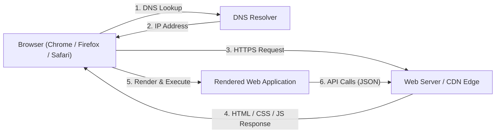
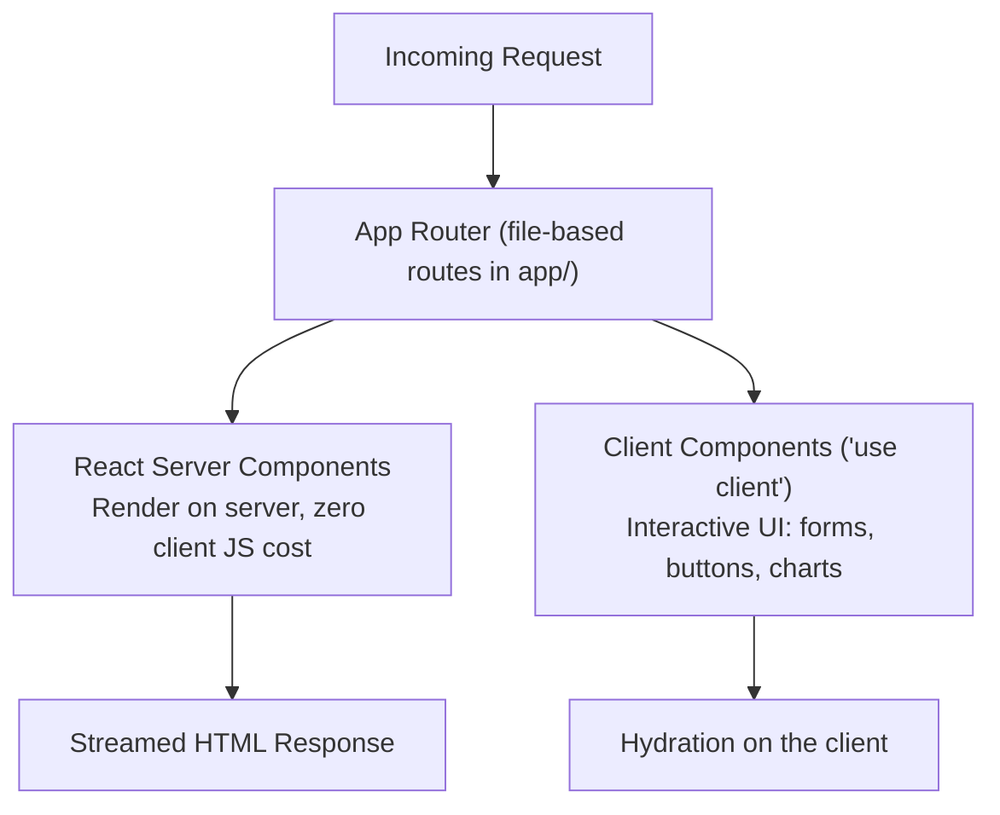

+++
title = "Web Development Roadmap"
weight = 1
description = "A comprehensive, practical guide to mastering modern web development: HTML, CSS, and JavaScript fundamentals, TypeScript, React 19, Next.js, full-stack backend engineering, testing, and production deployment."

[extra]
difficulty = "Beginner to Advanced"
estimated_time = "Ongoing Practice (4-6 months for core foundation)"
prerequisites = "Basic computer literacy; no prior programming experience required"
badge = "FULL-STACK"
toc_expand = true

# Landing page carousel
carousel_image = "roadmaps/web-development-cyber.webp"
carousel_title = "Web Development"
carousel_description = "Master modern web development with HTML, CSS, JavaScript, TypeScript, React 19, Next.js, full-stack backend engineering, testing, and production deployment."
+++

The web is the largest software platform ever created. Every product you interact with daily—social feeds, banking portals, dashboards, design tools like Figma, and document editors like Google Docs—is a web application running on standards maintained by the World Wide Web Consortium and shipped by every browser on Earth.

For college students, web development offers the fastest feedback loop in software engineering: you write code, refresh the browser, and see the result instantly. It is also the most employable specialization in the industry—every organization needs web presence, and the skills transfer directly into mobile development with React Native and desktop development with Electron and Tauri.

However, web development in 2026 is dramatically different from the tutorials of 2018. Modern engineering is **TypeScript-first**, built around **React 19** and meta-frameworks like **Next.js**, styled with **Tailwind CSS v4**, bundled by **Vite**, tested with **Vitest** and **Playwright**, and deployed on edge platforms with CI/CD pipelines.

This roadmap is designed by the **Computer Coding Club (CC), MNNIT Allahabad** to guide you from your first HTML tag to architecting, testing, and deploying production-grade full-stack web applications.

---

## 1. Orientation: The Modern Web Landscape

Before writing code, you must understand how the web platform works, how modern applications are rendered, and which specialization paths exist.

### 1.1 How the Web Works



* **The Client**: The browser—your rendering engine (Blink, Gecko, WebKit), JavaScript runtime, and UI. Modern browsers expose standardized APIs (DOM, Fetch, WebGL, WebAssembly) that work identically across platforms.
* **The Server**: Where application logic, databases, and business rules live. It responds to HTTP requests with documents (traditional sites) or JSON data (modern applications).
* **HTTP/HTTPS**: The request-response protocol of the web. Modern web traffic is exclusively **HTTPS** (TLS-encrypted), HTTP/2 or HTTP/3 multiplexed, and cached aggressively at CDN edges.

### 1.2 The Three Specializations

| Specialization | Focus | Core Technologies |
| :--- | :--- | :--- |
| **Frontend** | Everything the user sees and interacts with: layouts, interactivity, accessibility, performance | HTML, CSS, JavaScript, TypeScript, React, Next.js |
| **Backend** | Application logic, APIs, authentication, databases, integrations | Node.js (or Python/Go/Java), Express/Hono, PostgreSQL, Redis |
| **Full-Stack** | End-to-end product engineering across both layers | All of the above, plus deployment and DevOps basics |


**The 2026 Reality**: The line between frontend and backend is blurring. Meta-frameworks like Next.js render React components **on the server** (React Server Components), and platforms like Cloudflare Workers run JavaScript at CDN edge locations. Modern full-stack developers understand the entire request lifecycle.


### 1.3 Rendering Strategies: The Most Important Modern Distinction

Where and when your HTML is generated defines your application's performance profile:


graph TD
    Render["Rendering Strategy"] --> CSR["CSR — Client-Side Rendering<br/>Browser downloads an empty shell + JS bundle,<br/>then renders everything locally"]
    Render --> SSR["SSR — Server-Side Rendering<br/>Server generates full HTML per request"]
    Render --> SSG["SSG — Static Site Generation<br/>HTML pre-built at deploy time"]
    Render --> ISR["ISR — Incremental Static Regeneration<br/>Static pages refreshed in the background"]


* **CSR**: Ideal for highly interactive dashboards and tools (like Figma). Slower first paint, fastest subsequent interactions.
* **SSR**: Ideal for dynamic, personalized pages. Fast first paint, server load per request.
* **SSG**: Ideal for blogs, marketing sites, documentation. Fastest possible delivery from a CDN.
* **ISR**: Combines SSG speed with periodic freshness — the default choice for e-commerce and content sites.

Modern meta-frameworks (Next.js, Astro) let you **mix these strategies per route** — a marketing page can be static while the dashboard behind it renders client-side.

### 1.4 Where Are You Starting From?


graph TD
    Start["Your Starting Point"] --> T1["Track A: Complete Beginner"]
    Start --> T2["Track B: Some HTML/CSS Exposure"]
    Start --> T3["Track C: Developer in Another Language (Python / Java / C++)"]
    Start --> T4["Track D: Mobile Developer (React Native)"]

    T1 --> R1["Master HTML, CSS, and JavaScript fundamentals first — do not skip to frameworks"]
    T2 --> R2["Close the gap: responsive layout, accessibility, then deep JavaScript"]
    T3 --> R3["Map your language skills to TypeScript and learn the DOM/browser model"]
    T4 --> R4["Learn the web DOM layer under React Native; then Next.js for full-stack web"]

    R1 --> Core["Core Milestone: Deploy a responsive, accessible static site"]
    R2 --> Core
    R3 --> Core
    R4 --> Core


* **Track A (Complete Beginners)**: This roadmap is your starting point. Follow the stages in order — Stage 1 exists precisely so that frameworks make sense later instead of feeling like magic.
* **Track B (Some HTML/CSS Exposure)**: Skim Stage 1, but do not skip modern CSS (Grid, container queries) or the JavaScript fundamentals — most self-taught students have fragile JS foundations that collapse the moment frameworks arrive.
* **Track C (Developers from other languages)**: Your programming fundamentals transfer directly. Focus on Stage 2's browser-specific concepts (DOM, event loop, async browser APIs) and TypeScript's structural typing.
* **Track D (React Native developers)**: You already know React — the components, hooks, and state flow are identical. Learn the DOM, CSS layout in depth, and Stage 8's server-side patterns to become full-stack.

---

## 2. Stage 1: The Foundation Trinity — HTML, CSS & JavaScript

Frameworks come and go; HTML, CSS, and JavaScript are permanent. A weak foundation here is the single most common cause of "I can follow tutorials but can't build anything myself."

### 2.1 Semantic HTML: Structure With Meaning

HTML is not formatting — it is a document **semantics** layer that browsers, search engines, and screen readers all interpret:

* **Document Structure**: `header`, `nav`, `main`, `article`, `section`, `aside`, `footer` — semantic landmarks instead of anonymous `<div>` soup.
* **Forms & Inputs**: `form`, `input` types (`email`, `number`, `date`), `label` association, native validation attributes (`required`, `pattern`, `min`/`max`).
* **Media & Embeds**: `img` with `alt` text and `loading="lazy"`, `video`/`audio`, responsive images via `srcset`.
* **Accessibility Fundamentals**: Every interactive element reachable by keyboard, visible focus states, and meaningful `aria-label` attributes where semantics fall short.


**Why Semantic HTML Matters**: Screen readers announce a `<button>` as "button, clickable" and give it keyboard activation for free. A `<div>` styled to look like a button is invisible to assistive technology and breaks keyboard navigation. Accessibility is not a feature you add later — it is a property of correct HTML.


### 2.2 Modern CSS: Layout, Custom Properties & Responsive Design

* **The Box Model & Specificity**: Understanding margin collapse, the cascade, and specificity prevents 90% of "why isn't my style applying?" frustration.
* **Flexbox & Grid**: Flexbox for one-dimensional layouts (toolbars, card rows); Grid for two-dimensional page structure. Modern CSS layouts no longer need framework hacks.
* **Responsive Design**: Mobile-first media queries, fluid typography with `clamp()`, and **container queries** — the modern replacement for component-level media queries.
* **Custom Properties (Variables)**: `--color-primary: #E67E22;` theming, dark mode via `prefers-color-scheme`, and design tokens.
* **Modern Additions Worth Knowing**: Cascade layers, `:has()` selector, `aspect-ratio`, logical properties, and `text-wrap: balance`.

### 2.3 Modern JavaScript: The Language of the Browser

* **Core Language**: `let`/`const`, arrow functions, template literals, destructuring, spread syntax, modules (`import`/`export`).
* **Arrays & Objects**: `map`, `filter`, `reduce`, `find`, optional chaining (`?.`), nullish coalescing (`??`).
* **The DOM & Events**: `querySelector`, event listeners, event delegation, and the difference between the DOM you see in DevTools and the source HTML.
* **Asynchronous JavaScript**: The browser event loop, **Promises**, `async`/`await`, and `fetch` — the foundation every framework's data-fetching layer sits on.


**The Event Loop Is Why JavaScript Feels Different**: JavaScript runs on a single thread. Long-running synchronous work blocks all rendering and interaction — the reason `async`/`await` exists. If you internalize the event loop now, React's concurrent rendering and Node.js's non-blocking I/O will both feel obvious later.


#### Browser Developer Tools
Learn Chrome/Firefox DevTools deeply — they are your primary diagnostic instrument:
* **Elements panel**: Live DOM inspection and CSS debugging.
* **Console**: Logging, error stack traces, and API experimentation.
* **Network panel**: Inspecting requests, payloads, headers, and timing.
* **Lighthouse**: Automated audits for performance, accessibility, and SEO.

---

## 3. Stage 2: TypeScript — The Industry Standard

Every serious web codebase in 2026 is written in TypeScript. It is JavaScript with a compile-time type system that catches bugs before the browser ever runs your code.

### 3.1 Essential TypeScript for Web Development

```typescript
// 1. Typing data from APIs — model your server responses explicitly
interface Contributor {
  id: number;
  username: string;
  contributionsCount: number;
  avatarUrl?: string; // optional property
}

// 2. Discriminated unions for state — impossible in plain JavaScript
type RequestState<T> =
  | { status: 'idle' }
  | { status: 'loading' }
  | { status: 'success'; data: T }
  | { status: 'error'; message: string };

// 3. Narrowing: TypeScript tracks which case you are in
function renderState(state: RequestState<Contributor[]>): string {
  switch (state.status) {
    case 'idle': return 'Start exploring';
    case 'loading': return 'Loading...';
    case 'success': return `Found ${state.data.length} contributors`;
    case 'error': return state.message;
  }
}

// 4. Utility types for everyday transformations
type ContributorDraft = Omit<Contributor, 'id'>;
type ContributorPreview = Pick<Contributor, 'id' | 'username' | 'avatarUrl'>;
```

* **Configuration**: Start projects with strict mode (`"strict": true` in `tsconfig.json`) — it is harder for two weeks and dramatically better forever.
* **Structural Typing**: TypeScript compares shapes, not names — different from Java/C# nominal typing.
* **Generics**: Type-safe reusable functions and components (`useState<Contributor[]>([])`, generic API clients).

---

## 4. Stage 3: Modern Tooling & Project Workflow

Professional web development is tooling-heavy. Understanding *why* each tool exists prevents "black box configuration" syndrome.

* **Package Management**: `npm` (bundled with Node.js), `pnpm` (faster, disk-efficient), and semantic versioning in `package.json`.
* **Vite — The Default Build Tool**: Instant dev server with native ES module hot replacement, and optimized production builds via Rollup. Every non-meta-framework React project in 2026 starts with `npm create vite@latest`.
* **Code Quality**: **ESLint** for linting, **Prettier** or **Biome** for formatting. Biome is the modern all-in-one Rust-based alternative.
* **Version Control Discipline**: Feature branches, meaningful commit messages, and pull requests — see the [Open Source Contribution Roadmap](@/roadmaps/open-source.md) for the full Git workflow.
* **Browser Automation**: Playwright for cross-browser end-to-end testing (covered in Stage 9).

---

## 5. Stage 4: React 19 — The Component Model

React is the most widely used frontend framework in the world, the foundation of React Native, and the ecosystem your CC peers build on. Learn it deeply once and it transfers everywhere.

### 5.1 Components, Props & State

```tsx
import { useState } from 'react';

interface ProjectCardProps {
  title: string;
  stars: number;
  isPinned: boolean;
  onTogglePin: () => void;
}

export function ProjectCard({ title, stars, isPinned, onTogglePin }: ProjectCardProps) {
  return (
    <article className="project-card">
      <h3>{title}</h3>
      <p>⭐ {stars} stars</p>
      <button onClick={onTogglePin}>
        {isPinned ? 'Unpin' : 'Pin to top'}
      </button>
    </article>
  );
}
```

* **Declarative UI**: You describe what the UI should look like for any given state; React computes the DOM updates.
* **Props flow down, events flow up** — the unidirectional data flow that React Native, Vue, and SwiftUI all replicate.
* **State hooks**: `useState` for local values, `useReducer` for state machines, `useContext` for cross-tree data.
* **Effects**: `useEffect` synchronizes with external systems (network, timers, subscriptions) — and its cleanup function prevents memory leaks.

### 5.2 What React 19 Adds

* **Actions & `useActionState`**: First-class form handling with pending states, optimistic updates, and error handling built into the framework.
* **`use()` API**: Read promises and context conditionally, simplifying data fetching patterns.
* **Ref as a prop & document metadata**: `ref` no longer needs `forwardRef`; titles and meta tags render directly from components.
* **Server Components**: Components that render exclusively on the server (delivered via meta-frameworks — see Stage 6), eliminating bundle cost for non-interactive UI.

### 5.3 Data Fetching: TanStack Query

Manual `useEffect` + `fetch` + loading flags is boilerplate-prone. **TanStack Query** is the industry standard for server state:

```tsx
import { useQuery } from '@tanstack/react-query';

export function ContributorList() {
  const { data, isLoading, isError, error, refetch, isRefetching } = useQuery({
    queryKey: ['contributors'],
    queryFn: () => fetch('/api/contributors').then((res) => {
      if (!res.ok) throw new Error('Failed to load contributors');
      return res.json() as Promise<Contributor[]>;
    }),
    staleTime: 1000 * 60 * 5,
  });

  if (isLoading) return <p>Loading contributors…</p>;
  if (isError) return <p role="alert">Error: {error.message}</p>;

  return (
    <ul>
      {data.map((contributor) => (
        <li key={contributor.id}>{contributor.username}</li>
      ))}
    </ul>
  );
}
```

* Caching, background refetching, deduplication, and retry policies — solved once, industry-wide.
* The identical pattern powers the React Native roadmap's data layer, so learning it here transfers directly.

### 5.4 Client State: Zustand

For global client state (theme, session, UI preferences), **Zustand** is the lightweight modern standard — the same library the React Native roadmap recommends:

```typescript
import { create } from 'zustand';
import { persist, createJSONStorage } from 'zustand/middleware';

interface ThemeState {
  themeMode: 'dark' | 'light' | 'system';
  setThemeMode: (mode: 'dark' | 'light' | 'system') => void;
}

export const useTheme = create<ThemeState>()(
  persist(
    (set) => ({
      themeMode: 'system',
      setThemeMode: (mode) => set({ themeMode: mode }),
    }),
    { name: 'cc-theme', storage: createJSONStorage(() => localStorage) }
  )
);
```

### 5.5 Know the Alternatives



| Framework | Philosophy | When It Shines |
| :--- | :--- | :--- |
| **React 19** | Declarative components, massive ecosystem | Default choice: jobs, ecosystem, React Native transfer |
| **Vue 3 / Nuxt** | Progressive framework, gentle learning curve | Excellent DX; strong in Asia and enterprise |
| **Svelte 5** | Compile-time reactivity ("runes"), minimal runtime | Small bundles, elegant reactivity |
| **Astro 5** | Islands architecture, zero JS by default | Content sites, marketing pages, documentation |
| **Solid** | Fine-grained signals, no virtual DOM | Performance enthusiasts |

Learn React first — the component model transfers to all of them, and the job market overwhelmingly demands React.


---

## 6. Stage 5: Styling Systems in 2026

* **Tailwind CSS v4**: The utility-first standard. Version 4 rebuilt the engine in Rust (**Oxide**) with CSS-first configuration (`@theme` in your CSS instead of `tailwind.config.js`) — no config file needed for most projects.
* **When Tailwind, when CSS Modules**: Tailwind for application UI velocity and consistency; CSS Modules or vanilla CSS for component libraries and highly custom designs.
* **Design Systems Thinking**: Learn spacing scales, color tokens, and typography scales — components built from tokens stay consistent as the app grows.
* **Component Libraries**: shadcn/ui (Tailwind + React, copy-paste components you own) is the current default for production dashboards; use it to learn composition rather than fighting prebuilt themes.

---

## 7. Stage 6: Next.js & The Meta-Framework Layer

A meta-framework wraps React with routing, server rendering, and deployment conventions. **Next.js** is the industry default.

### 7.1 The App Router & React Server Components



* **Server Components** render on the server and can fetch data directly — no client-side fetch waterfall, no API round-trip for the initial view.
* **Client Components** (marked `'use client'`) handle interactivity; the two compose freely.
* **File conventions**: `page.tsx` (routes), `layout.tsx` (shared shells), `loading.tsx` (suspense fallbacks), `error.tsx` (error boundaries), `route.ts` (API endpoints).

### 7.2 Choosing Rendering Per Route

* Marketing pages and documentation → **SSG/ISR** (fastest, CDN-cached).
* Personalized dashboards → **SSR or CSR** depending on interactivity.
* Use `next/image` for automatic image optimization and `next/font` for self-hosted fonts — both eliminate entire classes of performance bugs.


**The Modern Default**: An interactive SPA (Vite + React Router + TanStack Query) for app-like products, or Next.js for content-heavy and hybrid products. Choose deliberately per project — neither is universally superior.


---

## 8. Stage 7: Backend Engineering for Web Developers

Frontend skills make you employable; full-stack skills make you dangerous. Every web developer should be able to build the server their UI talks to.

### 8.1 Node.js & The Server-Side Event Loop

Node.js runs JavaScript outside the browser using the same V8 engine and non-blocking event loop. The current LTS release is the right choice for all new projects.

* **HTTP servers**: Start with **Express** (timeless, minimal) or **Hono** (modern, TypeScript-first, runs everywhere including edge runtimes).
* **REST API Design**: Resource-oriented routes (`GET /projects`, `POST /projects`), correct status codes (`201` created, `400` validation, `401` auth, `404` missing, `500` server), and JSON request/response bodies.
* **Environment & Secrets**: Configuration via environment variables, secrets never committed — see the SysAdmin roadmap's secrets guidance.

### 8.2 Databases: PostgreSQL First


graph TD
    App["Backend Application (Node.js)"] --> ORM["ORM / Query Layer (Prisma or Drizzle)"]
    ORM --> DB["PostgreSQL (Relational, Default Choice)"]
    App --> Cache["Redis (Caching, Sessions, Rate Limiting)"]


* **PostgreSQL** is the modern default relational database: structured schemas, joins, transactions, and full-text search.
* **MongoDB** remains a reasonable choice for flexible document models — but do not pick a database because a tutorial did.
* **ORMs**: **Prisma** (schema-first, excellent DX) or **Drizzle** (SQL-like, edge-friendly) — both type-safe, both PostgreSQL-first.
* **Migrations**: Schema changes are versioned code, applied in order, never hand-edited in production.

### 8.3 Authentication Patterns

* **Session-based auth**: Server sets an HTTP-only cookie; the session lives in a store. Simple and secure for same-domain apps.
* **Token-based auth**: Signed JWTs (short-lived access + long-lived refresh) for APIs consumed by mobile clients or third parties.
* **OAuth providers**: "Sign in with Google/GitHub" via **Auth.js** — never roll your own OAuth flow.
* **Non-negotiables**: Passwords hashed with bcrypt/argon2, never stored plaintext; auth tokens never in `localStorage` when an HTTP-only cookie will do.

---

## 9. Stage 8: Testing — The Professional Divide

Testing is what separates tutorial projects from production engineering.

| Layer | Tool | What It Verifies |
| :--- | :--- | :--- |
| **Unit tests** | **Vitest** | Pure logic: formatters, reducers, API clients (mocking network with MSW) |
| **Component tests** | **React Testing Library** | Components render correctly and respond to user interaction |
| **End-to-end tests** | **Playwright** | Real browser flows: login → create project → verify persistence |

```typescript
// Vitest unit test for a pure function
import { describe, expect, it } from 'vitest';
import { formatStars } from './format-stars';

describe('formatStars', () => {
  it('abbreviates thousands', () => {
    expect(formatStars(1420)).toBe('1.4k');
  });

  it('returns raw count below 1000', () => {
    expect(formatStars(142)).toBe('142');
  });
});
```

* **The pyramid**: many unit tests, fewer component tests, a small set of critical E2E flows.
* **CI integration**: Run the full suite on every pull request — see the [DevOps Roadmap](@/roadmaps/devops.md) for pipeline patterns.

---

## 10. Stage 9: Performance, Accessibility & Web Vitals

### 10.1 Core Web Vitals

Google's user-experience metrics — and a direct ranking factor in search:

* **LCP (Largest Contentful Paint)**: How fast the main content appears. Target under 2.5s. Optimized by image optimization, SSR/SSG, and CDN delivery.
* **INP (Interaction to Next Paint)**: How responsive interactions feel. Target under 200ms. Optimized by breaking long tasks and avoiding render-blocking work.
* **CLS (Cumulative Layout Shift)**: Visual stability. Target under 0.1. Fixed by reserving space for images and ads (`aspect-ratio`, explicit dimensions).

### 10.2 Practical Performance Work

* **Measure first**: Chrome DevTools Performance panel and Lighthouse — never optimize blindly.
* **Bundle discipline**: Code splitting per route, `React.lazy` for heavy components, analyze bundles with `vite-bundle-visualizer`.
* **Images**: Serve modern formats (WebP/AVIF), responsive `srcset`, lazy-load below-the-fold media.
* **Network**: Cache headers, compression, and moving static assets to a CDN.

### 10.3 Accessibility Is Not Optional

* Semantic HTML covers 80% (Stage 1 was not optional).
* **Keyboard completeness**: Every flow completable with Tab/Enter/Escape; visible focus rings.
* **ARIA only when semantics fall short**: `aria-label`, `aria-expanded`, `role="alert"`.
* **Test with a screen reader** at least once (NVDA on Windows, VoiceOver on macOS) — it changes how you write HTML permanently.

---

## 11. Stage 10: Deployment & Production Operations

* **Static & SPA hosting**: Netlify, Cloudflare Pages, or GitHub Pages — free tier is plenty for student projects.
* **Full-stack hosting**: Vercel (Next.js-native), Cloudflare Workers, or a VPS running behind Nginx.
* **CI/CD**: GitHub Actions running lint, types, and tests on every push, deploying on merge to `main` — the [DevOps Roadmap](@/roadmaps/devops.md) covers pipeline engineering in depth.
* **Self-hosting is a superpower**: Running your own Nginx + TLS + systemd stack on a VPS teaches you what platforms automate — the [System Administration Roadmap](@/roadmaps/sysadmin.md) walks through it step by step.


**Own Your Production Path**: Deploy a real domain (free for students via the GitHub Education Pack) with HTTPS, custom CI, and monitoring. A live URL on your resume beats a local project every single time.


---

## 12. Six Progressive Milestone Projects

Theory without building creates tutorial dependence. Work through these six milestones in order — each one independently deployable and portfolio-worthy:


graph TD
    M1["Milestone 1: Portfolio & Landing Pages<br/>Focus: Semantic HTML, Modern CSS, Accessibility, Deployment"] --> M2["Milestone 2: PulseMetrics Web Converter<br/>Focus: Vanilla JavaScript, Modules, LocalStorage"]
    M2 --> M3["Milestone 3: DevPulse GitHub Explorer<br/>Focus: React 19, TypeScript, Vite, TanStack Query"]
    M3 --> M4["Milestone 4: Chronicle Notes Full-Stack<br/>Focus: Node.js, REST API, PostgreSQL, Auth"]
    M4 --> M5["Milestone 5: PulseBoard Analytics Dashboard<br/>Focus: Next.js, Server Components, Charts, Real-Time"]
    M5 --> M6["Milestone 6 (Capstone): OmniMarket Storefront<br/>Focus: ISR, Payments, Testing, CI/CD"]


### Milestone 1: Personal Portfolio & Product Landing Pages
* **Goal**: Build and deploy your professional portfolio site and one pixel-faithful product landing page (recreate an Apple or Stripe product page layout).
* **Core Concepts**: Semantic HTML5, Flexbox/Grid layouts, responsive breakpoints, dark mode with custom properties, Lighthouse-passing accessibility, and first deployment to Netlify or GitHub Pages.
* **Portfolio Value**: A live URL demonstrating layout discipline and accessibility fundamentals — no framework crutches.

### Milestone 2: PulseMetrics Web Converter
* **Goal**: An interactive unit and currency conversion tool in pure JavaScript — no framework.
* **Core Concepts**: ES modules, DOM manipulation, event handling, `fetch` against a public exchange-rate API, client-side persistence with `localStorage`, and error states for offline usage.
* **Portfolio Value**: Proves you can build interactive software with zero abstractions — the foundation frameworks stand on.

### Milestone 3: DevPulse GitHub Explorer
* **Goal**: A TypeScript React SPA exploring GitHub repositories with search, filters, and bookmarking.
* **Core Concepts**: React 19 components and hooks, TanStack Query for API caching, Zustand for bookmark state, Tailwind CSS v4 styling, and component testing with Vitest + React Testing Library.
* **Portfolio Value**: Industrial-grade API consumption and typed component architecture — the exact stack the React Native roadmap builds on next.

### Milestone 4: Chronicle Notes Full-Stack
* **Goal**: A full-stack note-taking application with user accounts, markdown rendering, and full-text search.
* **Core Concepts**: Node.js + Express/Hono REST API, PostgreSQL accessed via Prisma, session-based authentication with hashed passwords, CRUD endpoints with validation, and role-based access control.
* **Portfolio Value**: Demonstrates complete full-stack ownership: schema design, auth security, and API engineering.

### Milestone 5: PulseBoard Analytics Dashboard
* **Goal**: A data-dense analytics dashboard with charts, live-updating metrics, and exportable reports.
* **Core Concepts**: Next.js App Router with mixed rendering (server components for data, client components for charts), charting with a modern library, WebSocket or polling-based live updates, and Core Web Vitals optimization.
* **Portfolio Value**: Proves you can architect mixed-rendering applications and optimize real performance budgets.

### Milestone 6 (Capstone): OmniMarket Storefront
* **Goal**: A production-grade e-commerce storefront compiling from a single Next.js codebase: catalog, cart, checkout, and order history.
* **Core Concepts**:
  * ISR product pages with on-demand revalidation; SSR for personalized cart state.
  * Payment integration (Stripe test mode) with webhook order fulfillment.
  * PostgreSQL schema with migrations; seeded catalog data.
  * Auth.js authentication with role-based admin panel.
  * Playwright E2E suite covering browse → cart → checkout → order confirmation.
  * GitHub Actions CI/CD pipeline: lint, type-check, test, deploy on merge.
* **Portfolio Value**: A definitive capstone proving complete full-stack mastery — rendering strategy, payments, testing, and automated deployment.

---

## 13. Curated Official Resources

Deepen your web mastery using these vetted, authoritative sources:



















* **English — freeCodeCamp**: Full-length HTML/CSS, JavaScript, and React courses on YouTube.
* **English — The Net Ninja**: Short, focused playlist series on nearly every web technology.
* **English — Fireship**: High-level overviews and "100 seconds" intros — great for orientation, not depth.
* **Hindi — Chai aur Code**: JavaScript, backend, and full-stack series with strong fundamentals.
* **Hindi — Sheryians Coding School**: Frontend, animations, and project-based learning.
* Use video for orientation and momentum; use official documentation for actual mastery.


---

## 14. Where to Next in the CC Ecosystem

Web development is the hub of the CC roadmap ecosystem — nearly every other path connects to it:

* **[React Native & Expo Roadmap](@/roadmaps/react-native.md)** — take your React, TypeScript, and TanStack Query skills straight to native mobile apps. The single most natural next step for a React web developer.
* **[System Administration Roadmap](@/roadmaps/sysadmin.md)** — self-host your web projects: Linux servers, Nginx reverse proxies, TLS automation, and deployment operations.
* **[DevOps Roadmap](@/roadmaps/devops.md)** — automate your build, test, and deployment pipelines with Docker, GitHub Actions, and cloud infrastructure.
* **[Desktop Application Development Roadmap](@/roadmaps/desktop-development.md)** — turn your React skills into native desktop apps with Electron or Tauri.
* **[Open Source Contribution Roadmap](@/roadmaps/open-source.md)** — contribute to the frameworks and libraries you just learned — the highest-leverage way to deepen them.
EOF